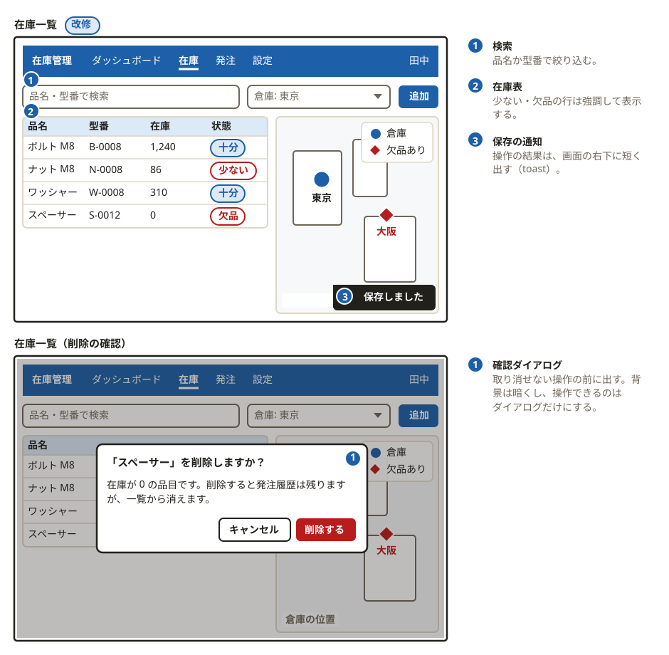

# svg-diagram

文書（仕様書・設計書）に入れる図を、宣言的な DSL で作るツール。構成図、フロー、スイムレーン、シーケンス図、表、**画面のワイヤーフレームと画面遷移図**に対応する。
レイアウト、重なり、コントラスト、ルール（WCAG・凡例・線の交差・幅）の検査まで自動で行う。SVG を手で描かず、ソース（`*.ts`。`*.mjs` も可）を直して再生成する。



## 導入

Node.js 22.18 以上と pnpm が必要。

### 案件のリポジトリに入れる（推奨）

npm パッケージとして配る（コンパイル済みの `dist/`＝JS と型定義が入っている）。`pnpm add` だけで入り、ブラウザのダウンロードはない。リリースタグ（`dist/` 入り）からも入る: `github:cuzic/svg-diagram#vX.Y.Z`。

    pnpm add -D typescript @types/node svg-diagram
    pnpm exec svg-diagram init          # package.json に "type": "module"、tsconfig.jsonを用意
    pnpm exec svg-diagram typecheck     # 図のソースを型検査（案件側の tsc を使う）
    pnpm exec svg-diagram build diagrams/*.ts

**ブラウザ（`playwright-chromium`）は要らない。** レイアウト、`build`（lint を含む）、`check`、`lint`、`show`、`preview`、`contact`、`renderSource` は、どれもブラウザなしで動く（文字幅はフォントファイルから、描画は resvg、描画後の検査は SVG の幾何から）。ブラウザが要るのは、実ブラウザで確かめたいときだけで、`pnpm add -D playwright-chromium`（pnpm 10 以降は `pnpm approve-builds` も）と `pnpm exec playwright install chromium` で足す: `lint --engine browser`、`show` / `preview` / `contact` の `--engine chromium`、`"measure": "chromium"`、`diagram({slide})` の空き寸法の実測（Slidev のテーマが実際に空ける余白を測る）。
CI で「SVG が最新か」だけ見るなら `svg-diagram check --drift diagrams/*.ts`（ソースのハッシュと SVG の埋め込み情報を比べるだけ。`--rebuild` を付けても、ブラウザは要らない）。

### 開発（このリポジトリ）

    git clone https://github.com/cuzic/svg-diagram.git
    cd svg-diagram
    pnpm install
    ln -s "$PWD/bin/svg-diagram" ~/.local/bin/svg-diagram   # dist/ が無ければ .ts を直接実行する

リリース: `package.json` の version を上げてから `pnpm release`（`dist/` を含むコミットにタグ `vX.Y.Z` を付ける。push は手動。そのコミットは main に入れない）。

**たくさんの図を作るとき**は、ソースを 1 回の呼び出しにまとめる（`svg-diagram build diagrams/*.ts --out-dir public/svg`）。文字幅の測定と lint の描画を、1 つのブラウザで済ませる（ソースごとに呼ぶと、そのたびにブラウザを起動して遅い）。
反復の作業中は `--no-lint` で lint を省ける（仕上げの build や `svg-diagram check` で通す）。
`--stale` を付けると、SVG が今のソース・ツールの版・`.svg-diagram.json` から作られたものならスキップする。判定に使うのは SVG に埋め込んだ生成元の情報（ソース・import しているローカルファイル・ツールの版・設定の各ハッシュ）。共通部品を直せば、それを使う図は古いと判定される。import は静的に読むだけなので、相対パスの import だけが対象（`tsconfig` の `paths` の別名や、変数で組み立てた `import()` は追えない。後者は build が警告する）。

`svg-diagram preview` / `contact` / `show` は SVG をブラウザなしで描く（Rust 製の resvg。フォントは、文字幅の測定に使うのと同じファイルを、その図で使う字だけに切り詰めて渡す。resvg は描くたびにフォントを丸ごと解析し直すので、14MB の日本語フォントだと 1 枚 3 秒かかるが、切り詰めると 50〜100ms で、画素は同じ）。`--engine chromium` を付けると、実ブラウザが `` として描いた絵になる（`playwright-chromium` が要る）。resvg が読めない環境（ビルド済みバイナリがない）では、`--engine` を省くと自動でブラウザに切り替わる。
`svg-diagram show` は人が端末で見るためのコマンド（Windows Terminal 1.22 以降、WezTerm、foot など sixel 対応の端末）。文書の `` と同じ読み方（XML）で描くので、整形式でない SVG はエラーになる。`.ts` は検証に落ちても描き、問題を stderr に出して終了コード 1 にする。tmux 3.4 未満は sixel を通さないので、`--passthrough`（`set -g allow-passthrough on` が要る）か `--png FILE` を使う。端末のない環境（エージェントなど）は `--png FILE` で書いて画像として読む。
動作確認: `pnpm test`、`svg-diagram build examples/inventory-wireframe.ts --out /tmp/x.svg`。

## 使い方

    svg-diagram init [dir]                               # 案件の初期設定（package.json の type、tsconfig.json）
    svg-diagram typecheck                                # 図のソースの型検査
    svg-diagram build <source.ts>... [--out file.svg | --out-dir DIR] [--stale] [--no-lint]   # 既定の出力: ./svg/<name>.svg
    svg-diagram build <source.ts> --dark --transparent   # 暗い配色／背景の矩形なしで描く（図の appearance / transparent を上書き）
    svg-diagram build <source.ts> --html                 # <name>.html も書く（文字・箱・表・線・矢印・曲線を HTML/CSS で。docs/adr/0006）
    svg-diagram check [--strict] [--verbose] <source.ts>...        # ルール検査（SVG は書かない）
    svg-diagram check --drift [--svg-dir DIR] [--rebuild] <source.ts>...   # 生成済み SVG が最新か（--rebuild: 再生成と比べ、違いを言葉で説明）
    svg-diagram check --covers 表.md|表.csv [--svg-dir DIR] <ソース.ts|図.svg>...   # 表を図に置き換えたとき、表のセルの語・数値が図に残っているか
    svg-diagram check --docs DIR [--svg-dir DIR] [--src-dir DIR] [--map]   # 文書（Markdown）と図が食い違っていないか（--map: 図・ソース・SVG・文書の対応表を Markdown で出す）
    svg-diagram notes <source.ts>                        # 図の番号つき注釈を Markdown のリスト（1. **題名**：本文）で出す。文書に貼る
    svg-diagram diff old.svg new.svg                     # 2 つの SVG の違いを言葉で（見た目が変わるか）
    svg-diagram contact a.svg b.svg ... --out sheet.png [--cols N] [--width PX]  # 図の集まりを 1 枚に並べて、一度に目視する
    svg-diagram lint  [file.svg ...] [--strict] [--fix] [--engine geometry|browser]   # 描画後の検査も、既定は SVG の幾何から（ブラウザなし）
    svg-diagram preview <in.svg> <out.png> [scale] [--engine resvg|chromium]   # 既定の倍率 2
    svg-diagram show <file.svg|file.ts>... [--png FILE] [--scale N] [--width PX] [--engine resvg|chromium]   # ターミナルに sixel で直接表示（.ts は SVG を書かずに作って描く）

型もすべて同じ所から取れる: `import type {WfNode, TableCell, TextTone, RawColorTone} from 'svg-diagram'`。変数に切り出した表のセルは `cell('通る', {tone: 'accent'})` で作ると、tone が文字列に広がらない（`as const` でも可）。`row()` に入れられるのは `box()` と `group()`、`grid()` は `box()` だけ（違うものを入れると実行時エラー）。

ソース: `import {diagram, box, ...} from 'svg-diagram'` / `export default () => diagram({theme: 'blue'})...`
`theme`: blue | teal | amber（docs 向け。スライド警告なし）。`day: 1|2` は研修スライド用（slide-fit 警告あり）。

## 部品
| 部品 | 用途 |
|---|---|
| image(src, {alt, marks, labels}) | 絵（PNG / JPEG / GIF / WebP）を部品として置き、上に印（`marks`）と文字（`labels`）を重ねる。ファイルは data URI で SVG に埋め込まれる（下の「絵を置く」） |
| caption / box / banner / spacer / raw | 基本。box は tag・tagAt・tone(new/changed/removed/accent/muted/danger/plain、box / banner / stat は solid / solid-danger も) |
| row / grid | 横並び（row は cols:N の共有列グリッド、span/col。`cols: [6, 6]` と span を並べて書ける。`id` を付けると、`r.col(5).top` で N 列目を接続点にできる） |
| node({icon, label, sub, size, frame}) | 構成図の 1 点: アイコンを大きく（既定 48px）中央に置き、名前を下に付ける。枠は付けない（`frame: true` で付く）。`row()` / `grid()` に並べ、`group()` でネットワーク・VPC・ゾーンの境界を作り、`connect()` で結ぶ（下の「構成図（クラウド・ネットワーク）」） |
| group(children, {title, tone, titleAlign, flex, width, span, col}) | ラベル付きの枠。**入れ子可**（ホスト > コンテナ > プロセス）。`row([group(...), group(...)])` で横に並べると、枠の高さは一番高いものにそろう（`flex` / `width` / `span` / `col` は box と同じ。`arrows: 'between'` は不可）。中の box の id も、`connect()` の参照先になる |
| versus(left, right, {shared, connectLabels}) | 左右の `group()` を 12 列の半分ずつに並べる対比。各部は `{title, children, tone, id}`。`shared` を付けると、その共通部を下に置いて左右から接続する（3 部すべてに `id` が必要）。接続ラベルは `connectLabels.left` / `.right` |
| connect / branch | 矢印。route(straight/elbow/loop-under)、arrow(end/both/start/none)、line(solid/dashed/dotted/double)、weight(strong)、chip、labelAt、アンカー `id:side@0.2` |
| legend(items) | 線種・トーンの凡例 |
| swimlane(lanes, steps, {flows, phases}) | スイムレーン図。レーン=担当（人・チーム・システム）、列=時間。引き継ぎの矢印を自動で向きづけ。`col` で並行作業を揃える |
| sequence(actors, steps) | シーケンス図。message / self / note / divider、自動番号 |
| table(columns, rows, {title}) | 見出し付き表（ER の entity 兼用）。セルは {text, tone, bold, mono}、`cell('通る', {mark: 'ok'})` で ○△×◎ の記号つき（色だけに頼らない） |
| wireframe(root, {title, tag, h, frame, notes, skeleton}) | 画面 1 枚のローファイ・ワイヤーフレーム + 番号つき注釈欄。部品は `wf.*`（下記）。`n:` で番号の丸、`mark:'new'/'changed'` で新規・改修の枠 |
| screens(items, {cols, gap, rowGap, h, skeleton}) | 画面のサムネイルを並べる（画面遷移図）。item の `at:[行, 列]`（列は小数可）で配置、各 `id` を `connect()` で結ぶ。`skeleton` で文字を帯に |
| stateMatrix(cols, rows, {required, cellH, cellFrame}) | 部品の**状態の一覧**。行=部品、列=状態（通常・読み込み中・空・エラー…）。欄は `wf.*` の図、`'na'` / `{na: '理由'}`（対象外）、未指定（**未設計**。`check` が警告）。`required` の列がなければ警告。行は `stateRow('在庫カード', stock, {通常: {}, 読み込み中: 'loading', ...})` で「部品 1 つ + 状態ごとの差分」としても書ける |
| timeline({from, to, now, deadline, marks, remaining}) | 横軸が時間の部品。期限（danger 色の大きな点）、今日、途中の日付（`marks`）を旗で示し、今日から期限までを太い帯と「あと 1 年 5 か月」で見せる。詳細は下の「時間軸と期限」 |
| tree(root, {dir, maxNodeW, id}) | 組織図・階層図。配置は自動（親は子の中央、同じ階層は揃う）。節は `{label, sub?, id?, tone?, children?}`。`id` を付けた節は `connect()` の端点になる（`t.anchors.<id>` でも取れる）。詳細は下の「組織図（`tree`）」 |
| mindmap(root, {layout, edges, sides, maxNodeW, id}) | マインドマップ。節は `tree()` と同じ。`layout` で形を選ぶ: `radial`（既定。中央から左右へ）/ `right`・`left`（片側。ロジックチャート）/ `down`・`up`（ツリー）/ `org`（組織図型）/ `list`（リスト・アウトライン型）/ `brace`（ブレース型）/ `fishbone`（特性要因図）/ `timeline`（タイムライン型）。`edges` で枝を `elbow`（既定）・`curve`・`straight` に。`sides: {枝の id: 'left'｜'right'}` は `radial` のとき、ルートの子を左右に固定する。下の「組織図（`tree`）」 |
| stateDiagram(states, transitions, {initial, dir, maxNodeW, id}) | 状態遷移図。状態 `{id, label, sub?, tone?, final?}` と遷移 `{from, to, label?, line?}` を書くだけで、層に分けて自動配置する。戻る矢印・飛ばす矢印・自己ループも、ほかの状態を避けて引く。状態は `connect()` の端点になる。詳細は下の「状態遷移図（`stateDiagram`）」 |
| causeTree(nodes, links, {dir, maxNodeW, id}) | TOC（制約理論）の因果の図: 現状ツリー・未来現実ツリー・前提条件ツリー・移行ツリー。実体 `{id, label, role?}` と `{from, to}`（`from` を配列にすると AND）を書くだけで、下が原因・上が結果に自動配置する。詳細は下の「TOC の思考プロセス」 |
| cloud({a, b, c, d, d2}, {assumptions, conflictLabel, id}) | TOC のクラウド（対立解消図）。共通目的 A・必要条件 B/C・対立する要望 D/D' の 5 つの箱と、前提の番号付き一覧。詳細は下の「TOC の思考プロセス」 |
| gantt(rows, {from, to, today, id}) | ガントチャート。行は、タスク `{label, start, end｜days, id?, progress?, after?, tone?, milestone?}` と、見出し `{section}`。日付は `'YYYY-MM-DD'`（`end` はその日を含む。`'2026-10'` のような略記は止まる）。軸・目盛り・今日の線・依存の矢印・進捗は自動。詳細は下の「ガントチャート（`gantt`）」 |
| classDiagram(classes, relations, {dir, id}) | UML クラス図。クラス `{id, name?, stereotype?, abstract?, attrs?, methods?, tone?}` と関係 `{from, to, kind?, label?, fromMult?, toMult?}`。親が上になる層に自動配置し、矢印の端の記号は `kind` で決まる。詳細は下の「クラス図（`classDiagram`）」 |
| bpmn(lanes, nodes, flows, {id}) | BPMN 風の業務フロー。レーン（担当）に、タスク・開始/終了イベント・ゲートウェイ（排他 `xor`・並行 `and`・包括 `or`）を置き、矢印で結ぶ。列は流れから、行はレーンから決まる。破線は、レーンをまたぐメッセージ。詳細は下の「業務フロー（`bpmn`）」 |
| pareto(items, {top, other, guide, highlight, unit}) | パレート図（QC 七つ道具）。項目 `{label, value}` を大きい順の棒にし、右の 0〜100% の軸に累積比率の折れ線。80% に届くまでの項目だけ色が付く。詳細は下の「QC 七つ道具と新 QC 七つ道具」 |
| histogram(values, {bins, width, lsl, usl, target, normal}) | ヒストグラム。測定値をそのまま渡す。区間の幅は切りのよい数、棒は接し、区間の境目が下に付く。規格の上下限・平均・正規分布の曲線 |
| scatter(points, {x, y, regression}) | 散布図。軸は点に合わせて自動。`group` で層別（色と形が変わる）、`regression: true` で回帰直線と相関係数 r（`plane` を返す） |
| controlChart(type, data, {limits, at, rules}) / xbarR(subgroups) | 管理図。`'x'｜'mr'｜'xbar'｜'r'｜'p'｜'np'｜'c'｜'u'`。中心線と 3σ の管理限界を計算し、外れた点（✕）・連と傾向（○）を赤にする（`plane` を返す） |
| checkSheet(items, columns, {as, total, boxes}) | チェックシート。件数は「正」の字、計の行と列は自動。`counts` なし・`boxes: true` で手書き用の空の用紙（`table` を返す） |
| matrix(rows, cols, cells, {weights, values, total}) | マトリックス図（L 型）。◎ ○ △ × の記号、重み付きの評価点と最高点の印（`table` を返す） |
| canvas(template, content, {title, emphasis, id, h}) | 枠が決まったキャンバス。`bmc`（ビジネスモデルキャンバス）・`lean`・`vpc`・`swot`・`tows`・`errc`・`pest`（`pestle: true` で PESTLE）・`threeC`・`sevenS`・`fiveForces`・`empathy`・`persona`・`a3`。内容は領域ごとの箇条書き（`grid` を返す） |
| affinity(groups, {cols, cardCols}) | 親和図。カードを表札付きのグループに、グループの中にグループを入れ子にできる（`group` と `row` を返す） |
| relationDiagram(nodes, links, {problem, counts}) | 連関図。要因と因果の矢印（戻る矢印も可）。出る矢印・入る矢印の数を書き、出る矢印が最多の要因を主原因に（`causeTree` を返す） |
| pdpc(nodes, links, {dir}) | PDPC 法。道筋（実線）と、懸念（六角形）・対策（点線）。`role`: start / step / risk / measure / goal（`causeTree` を返す） |
| arrowDiagram(activities, {dir, times, summary}) | アロー・ダイヤグラム。丸が結合点、矢印が作業。最早/最遅の時刻・余裕・クリティカルパス（赤い太線）を計算する（`stateDiagram` を返す） |
| waterfall(steps, {unit, dir, axis, connectors}) | ウォーターフォール図。開始 `{label, value}`・増減（`value` は ± の差）・小計/合計（`kind: 'subtotal'｜'total'`、`value` なしで累計）。棒は前の水準から浮き、コネクタで水準をつなぐ。値は `+220` / `-130` と符号つきで必ず書く。詳細は下の「コンサル系のチャート」 |
| radar(axes, series, {max, values, unit}) | レーダーチャート。3〜12 軸・1〜4 系列。同心の目盛りに値、系列は線の種類と印の形（○ □ ◇ △）が違い、凡例に同じ線と印が出る |
| heatmap(rows, cols, values, {unit, levels, corner, scale}) | ヒートマップ・コホート表・リテンション表。セルには数字を必ず書き、濃さは 3〜6 段階。`null` は空欄（–）。段階の凡例つき |
| lines(series, {x, y, target, annotate}) / strategyCanvas / burndown / burnup | 折れ線（`plane` の薄い層）。系列ごとに印の形と線の種類が違い、名前は線の右端に直接書く。目標線・注目点。戦略キャンバス・バーンダウン・バーンアップのひな形つき |
| stackedBars(columns, {unit, percent}) / mekko(columns, {unit}) | 積み上げ棒（`percent: true` で 100%）とマリメッコ図（列の幅 ∝ 合計、高さ ∝ 構成比）。各部分に数字。入らない部分は描かず `<desc>` に残る |
| treemap(tree, {unit, percent, strict}) | ツリーマップ（squarified）。面積 ∝ 値（グループの枠と見出しの分も補正し、グループの中でも外でも同じ比）。名前と値が入らない小さなセルは描かず `<desc>` に残る（`strict: true` はエラー） |
| sankey(nodes, links, {unit, align}) | サンキー図。層に分け、ノードの高さとリボンの太さは値に比例（目盛りは図全体で一つ）、ノードの名前に値、重ならない。リンクのないノードはエラー |
| tornado(items, {base, unit}) | トルネード図（感度分析）。基準値から低ケース・高ケースの棒、幅の大きい順 |
| pyramid / curve | ピラミッド、曲線 |
| people(total, count, {cols, size, gap, align, tone, alt}) / dots(values, {zones, lowLabel, highLabel, min, max, r}) | 人数の絵（`people(100, 76)` = 100 人中 76 人）、レーン上の点の分布。下の「人数の絵とレーン上の点」 |
| quadrant({x, y, grid, cells, items, arrows, preset}) / quadrant.preset(name, opts) | 象限図・分類マトリクス（2×2・3×3・任意の N×M）。軸は名前と両端の言葉（`x: {title, low, high, reversed}`）、マスは文字の見出し（`cells[行][列]`: `{title, note, tone}`）、項目は `{label, cell: [列, 行]｜at: [x, y], size?, tone?, group?, id?}`。プリセット `bcg｜ge｜ansoff｜nineBox｜impactEffort｜risk｜stakeholder｜positioning｜eisenhower`。重なりは出ない。詳細は下の「象限図・分類マトリクス」 |
| chevron / funnel / cycle / venn / concentric | 流れ・絞り込み・循環・集合・階層を表す flowShapes。各項目の `id` は `connect()` / spotlight の対象。詳細は下の「flowShapes」 |
| plane({x, y, points, lines, dims, labels}) | 座標平面。軸・目盛り・点・補助線・**寸法線**・ラベルを、座標の単位のまま宣言する（地図 ↔ 画像の座標変換、位置の誤差）。`yDown: true` で画像座標。ラベルが、他のラベル・軸と矢印・目盛り・点・補助線・寸法線に重なる、または図からはみ出すと検査で止まる（寸法線の文字は、その線の上に載るのが正） 。`paths: [{through: [点の id か座標…], smooth?, dashed?, tone?, arrow?, reveal?}]` で複数点を通る線を引く（実線が既定。`smooth: true` は点を必ず通る曲線で、x が増える道筋は単調な 3 次補間（値を行き過ぎない）、そうでない道筋は centripetal Catmull-Rom。`smooth` なしは折れ線。曲線が軸の外に出る・ラベルに重なると検査で止まる。`examples/plane-paths.ts`）。`grow: true` を付けた path は、段階（`reveal`）ごとに、出ている点までの曲線を同じ形のまま伸ばす（`examples/plane-grow.ts`）。点のラベルは `labelAt` を書かなければ右に置き、線や他のラベルと重なるときは空いている側（左・上・下・斜め）へ自動で移る。`labelAt` で側を書くとそのまま、`labelOffset: [dx, dy]` で位置をずらせる |

`wf.*`: col / row / card / spacer、text / btn / input / select / chip / tabs / appbar / seek、kv / stat / list / table / alert、map / video / heat / pointcloud / chart / image。
map・video 等は残りの高さを埋める。`overlay` / `overlayRight` でチップ、`label` / `stamp` で枠内の文字。

**画面全体は粗く、部品は別の図で詳しく**（ワイヤーフレームの進め方）:

- 粗い全体像: `wf.region(名前, {n, emphasis, hint})`。領域の名前と見る順だけを示す。`n: true` で、読む順に自動採番。
- 部品の構成: `wireframe(部品, {frame: 'light' | 'none', h: 'fit'})` で、画面の太い枠を使わず、中身の高さに合わせる。`parts: {level: 1, evidence: 2}`（または `true` で自動採番）で、部品の**内側**に番号を付けられる（`wf.insight`、`wf.robot`、`wf.fusion`、`wf.compare`）。
- 部品の状態: `stateMatrix()`。`state: 'missing' | 'disconnected' | 'loading' | 'empty' | 'stale'` は、**どの部品にも**付けられる（映像・地図は斜線、一覧・カード・数値は骨組み。`stale` は読めるまま、点線の枠と札）。`fusion` の `layers: [{label, state}]` で、層ごとの状態も示せる。
- 部品: `wf.fusion`（カメラ・点群・赤外線の重ね）、`wf.compare`（左右の比較）、`wf.robot` / `battery` / `signal`（機体状態）、`wf.insight`（根拠と取得時刻が必須の所見）、`wf.breadcrumb`、`wf.toggle` / `checkbox` / `radio` / `slider`、`heat` の `scale` / `probe`、地図マーカーの `id` / `shape` / `heading` / `fov`。
- `check` が見ること: 図の番号と注釈の一対一（`wf-callout-no-note` / `wf-note-no-callout` / `wf-callout-gap`）、状態の一覧の「未設計」と必須の状態（`wf-states-todo` / `wf-states-required`）。

### 小さな制約の解消（枠なしの group、表の行高、stamp）

- `group(children, {frame: false})`: 枠も title も付けない入れ物（pad 0）。row に table / plane / banner を並べるとき、group で包んでも外枠が二重にならない。`title` / `tone` / `dashed` と一緒には使えない（出ないので throw）。
- `table(columns, rows, {cellH})`: 全行（見出しも）を同じ固定高にして、文字を縦中央にそろえる。足りなければ throw（伸ばさない）。未指定の表は従来どおり。`stateMatrix` の `cellH` と同じ意味。
- 表の行ごとの高さ: 行を `{cells: [...], h: 60}` と書くと、その行だけ固定高にする。見出し行は `table(..., {headerH: 30})`。優先順は 行の `h` > `headerH`（見出し行のみ）> `cellH` > 内容に合わせた高さ。固定した行は文字を縦中央にそろえ、足りなければ `h` / `headerH` / `cellH` のどれが小さいかを書いて throw する（伸ばさない）。
- `table(..., {dense: true})`: 行の上下の余白を 8px から 4px に詰める（文字は 14px のまま。title の帯は変えない）。`cellH` / `h` / `headerH` と併用でき、固定高が優先される。ただし「その行に必要な高さ」は dense の余白で計算するので、dense なしでは足りない高さでも dense なら通る。`h` / `headerH` / `dense` を使わない表の出力は変わらない。例は `examples/table-row-h.ts`。
- `table(columns, rows, {rowHeader: true})`: 左端の列を行ラベルにする。行ラベルのセルは**常に `soft` で塗り、太字**にし、右側に太い縦罫線（幅 3、文字色）を引く（塗りに頼らない区別）。見出し行との左上のセルは見出し行のまま。`cellH` / 行の `h` が無いときは本文と同じく上揃え、あるときは縦中央。行ラベルの折り返しも行の必要高さに入り、`h` / `headerH` / `dense` / `cellH` と併用できる。行の `tone` が `accent` / `new`（塗りが `soft`）だと行ラベルと本文が同じ塗りになるので `rowheader-tone-collides` を warn する（`muted` / `removed` は塗りが `code` なので出ない）。列が 1 つだけだと throw。`rowHeader` を使わない表の出力は変わらない。例は `examples/table-row-header.ts`。
- `stamp: '架空の例'`: box / banner / group の右下に小さなチップを出す（「架空の例」「イメージ」「要確認」）。内容の下に 1 段ぶんの帯を確保するので、本文に重ならない。箱より幅が広いスタンプは throw。画面部品（wf）の `stamp` は従来のまま。

## くり返しをまとめる書き方
同じ指定を図の中で何度も書くときの、まとめ方。

### 大きな数値と棒グラフ

`stat(value, label, opts)` は、大きな値と補足ラベルを中央揃えにした plain の `box()` を返すため、そのまま `row()` に入れられる。`size` は `'stat'`（34px、既定）または `'display'`（56px）。`tone` は値の文字だけに付き、ラベルは muted、箱の見た目は変わらない。値は折り返さず、幅に収まらない図は検証エラーになる。

```ts
row([
  stat('76%', '導入前', {tone: 'danger'}),
  stat('31%', '導入後', {tone: 'accent', size: 'display'}),
])
```

`bars(data, opts)` は横棒（既定）、縦棒（`dir: 'v'`）、積み上げ（`stack: true`）を描く。`series` は `a | b | c` で、それぞれ accent / text / muted。棒ごとに `tone: 'accent' | 'danger' | 'muted'` も選べる（`danger` が赤。`series` とは併用できない。`examples/spotlight-dim-fill.ts`）。`max` を省くと通常は最大値、積み上げでは合計値になる。値ラベルは必ず描かれ、`unit` は値の後ろに付く。各項目の `id` は `connect()` のアンカーとして使える。

```ts
bars([
  {id: 'before', label: '導入前', value: 76, series: 'a'},
  {id: 'after', label: '導入後', value: 31, series: 'b'},
], {max: 100, unit: '%'})

bars([
  {label: '企画', value: 16, series: 'a'},
  {label: '実装', value: 34, series: 'b'},
  {label: '運用', value: 50, series: 'c'},
], {max: 100, unit: '%', stack: true})
```

出し分けの指定（既定はすべて従来どおり）。

| 指定 | 内容 |
|---|---|
| `labels: 'all' \| 'category' \| 'none'` | 値ラベルとカテゴリラベルの両方（既定）／カテゴリだけ／どちらも出さない |
| `axis: false` | 目盛りの数値・目盛り線・値の軸線を消す。棒の立つ基線は残る（横棒は x = 0 の縦線を引く） |
| `grid` | 目盛りに沿った格子。既定は `axis` に連動。`axis: false, grid: true` は throw |
| `baseline: false` | 基線も消す |
| `barRatio` | 棒の幅の比率（0 < r ≤ 1）。指定すると最大幅の上限（縦棒 64px）を外す。`1` で棒が接して階段になる。横棒は行の高さ（28+18）に対する棒の高さ。省略時は従来の幅。`stack` とは併用できない |

`labels` が `'all'` でなく `axis: false` のとき、図から値は読めない。ハードル（高さが値に比例する壁）や階段のような「量の感じ」を見せる図で使い、**数値は本文・`caption`・隣の表など図の外に必ず書く**（長さや色だけで量を伝えない）。そのとき SVG の `<desc>` に値の列（`値: A 20%、B 40%`）を自動で追記する（`diagram({desc})` を自分で書いた図には追記しない）。doc 媒体で題名がない図は、`<title>` も `<desc>` も出ないので `bars-values-hidden` で warn する。reveal の段階ごとのファイルの `<desc>` は、その段階で見えている要素だけを挙げる（まだ出ていない値・消えた値は入らない）。目盛りも値ラベルも出さない縦棒は、`height: 60` のような小さい図が書ける（目盛りか値ラベルがあるときの最小の高さは従来のまま）。棒が 1px 以下になる図は throw ではなく `bars-thin-bar` の warn。例は `examples/bars-bare.ts`。

### 人数の絵とレーン上の点（people / dots）

`people(total, count, opts)` は、人のアイコン `total` 個を行ごとに並べ、先頭の `count` 個を強調する（「100 人中 76 人」）。強調は塗りつぶし、残りは輪郭だけなので、色が見えなくても数が読める。`cols` の既定は 10 個以下ならその個数、それ以上なら平方根の切り上げ（100 → 10 列）。

- 色: `tone`（強調の塗り。`'accent'` 既定 / `'danger'` / `'muted'`）と `rest`（輪郭の色。既定 `'muted'`）。「悪い数字」に見せたくないときは `accent`、灰色の図（例: 経営者の認識）は `tone: 'muted'`。
- 2 色: `people(100, [35, 47], {tone: 'accent', tone2: 'danger'})` は、先頭の 35 個を `tone`、続く 47 個を `tone2`、残りを `rest` で描く（`k1 + k2 > total` は throw。`tone2` の既定は `danger`、`tone` が `danger` なら `accent`）。2 色は色だけの違いなので、`side` / `alt` / 近くの文に**どちらが何人かを書く**（`examples/people-two-tone.ts`）。
- 数字: `side: {value: '76%', label: '離脱した', tone?, size?: 'stat' | 'display'}` で、グリッドの右横・縦中央に大きい数字と一行のラベルを置く（`stat()` を下に積むより縦が短い）。`side` の `tone` は数字の色で、アイコンの `tone` とは別に選べる。
- 寸法: アイコンは `size`（既定 28px）、間は `gap`（既定 8px）。10 列の幅（高さ）は `10 × size + 9 × gap` で、`size: 28, gap: 8` なら 352px、`size: 24, gap: 6` なら 294px、`size: 20, gap: 4` なら 236px。`side` を付けると、これに 24px + 数字の幅（`stat` で約 100px、`display` で約 150px）が足される。10×10 を 2 つ縦に積むと 600px を超えるので、スライドでは `size: 20〜24` にするか、`row([group([people(...)], {frame: false}), group([...], {frame: false})])` で横に並べる（`examples/people.ts`）。
- そのほか: `align`（`'center'` 既定 / `'left'`）、`alt`（既定 `76 / 100`）、`id`。列に収まらないときは throw（`cols` / `size` / `gap` を見直す）。`side` を付けない図では数字の文字を持たないので、`stat()` / `caption()` を並べる。数字は図の外にも書く前提（ADR 0002 の量の部品と同じ）。

`dots(values, opts)` は、横のレーン（軸）に点を置く。値は `min`..`max`（既定 0..1）の位置で、近い点は上へ積むので**点は決して重ならない**（座標は 4px 格子に載るので lint の `coordinate-grid` も通る）。`zones: [{from, to, label, tone?}]` はレーンの一部を、淡い色の帯（点の背景）と軸上の濃い帯で示し、ラベルを下に置き、帯の中の点を `tone`（既定 `'danger'`）の濃い色で塗る。点は既定で半径 10px（直径 20px。`r` で 2〜24px）（点ごとに `{at, tone}` で上書き可）。帯は重ねられず、ラベルが互いに重なる・図からはみ出す・`height` が一番高い山に足りないときは throw。`lowLabel` / `highLabel` は両端の文字、`r`（10px）、`width` / `height`、`alt`、`id`（`spotlight` の対象にできる）。`reveal` は付けられない（`examples/dots-lane.ts`）。

```ts
people(100, 76, {tone: 'danger', alt: '100 人中 76 人'})
dots([0.04, 0.1, 0.12, 0.5, 0.9], {
  zones: [{from: 0, to: 0.3, label: 'ついてこれない人'}, {from: 0.3, to: 1, label: 'ついてこれる人', tone: 'accent'}],
  lowLabel: '遅い', highLabel: '速い',
})
```

### 組織図・階層図（`tree`）

```ts
tree({
  label: '開発本部', sub: '本部長', tone: 'accent',
  children: [
    {label: 'プラットフォーム部', id: 'pf', children: [{label: 'インフラ'}, {label: 'SRE'}]},
    {label: 'プロダクト部', children: [{label: 'Web'}, {label: 'モバイル'}]},
  ],
}, {dir: 'down'})
```

- 座標は書かない。親は子の列の中央に、同じ階層は同じ高さ（`dir: 'right'` なら同じ左端）に並び、重ならない。配置の計算は `lib/graph-layout.ts`（ほかの自動配置の図と共通）。
- 節は、太字の `label` と、薄い `sub`（役職・人数など）。`maxNodeW`（既定 200px）を超えると折り返す（句読点はぶら下がることがある）。`tone` は `box` と同じ。
- 兄弟が多くて図の幅を超えるときは、何が足りないかを書いて止まる（`dir: 'right'`、`maxNodeW` を小さく、階層を分ける）。
- `id` を付けた節は、`connect()` の端点（`connect('pf', '外部')`）。`tree()` 自身の `id` は、図全体の端点と spotlight の対象。`reveal` は図全体に付く。例は `examples/org-chart.ts`、`examples/org-chart-right.ts`。

`mindmap(root, {layout, edges, sides})` は同じ節の書き方で、`layout` を替えるだけで形が変わる（既定は `radial`）。

| `layout` | 形 | 使いどころ |
|---|---|---|
| `radial` | ルートを中央に、枝が左右へ。書いた順に、前の半分を右、残りを左へ振り分け（高さで釣り合わせ、どちら側も上から下へ）。`sides` でルートの子を左右に固定 | 発想、全体像 |
| `right` / `left` | 起点を左（右）端に置き、片側へ親→子→孫と展開（ロジックチャート） | 大きなテーマを分解する |
| `down` / `up` | 上（下）から下（上）へ分岐するツリー。兄弟が多いと幅を超える | 分類、階層 |
| `org` | ルートの下に子が横一列、各子の下に子孫のリストが字下げでぶら下がる（組織図型） | 組織、役割 |
| `list` | 全ノードを縦に並べ、字下げで階層を示す（アウトライン） | 議題、ToDo |
| `brace` | 右へ展開し、親から子へ `{` のブレースで分解する（ブレースマップ） | 全体と部分の分解 |
| `fishbone` | ルートが魚の頭（右）、背骨に斜めの骨。ルートの子がカテゴリ（大骨）、その子が原因（中骨）、孫以下は原因の下に字下げでぶら下がる（小骨。下半分の骨では上下が逆になり、小骨が原因の上に付く）。特性要因図（`examples/qc-fishbone.ts`） | 原因分析 |
| `timeline` | ルートを左端に、横の軸に沿って子を上下交互に並べ、各子のリストが軸から遠ざかる向きに伸びる | 経緯、計画 |

`edges: 'curve' | 'straight'` は、`radial` / `right` / `left` / `down` / `up` で枝の線を滑らかな S 字・直線にする（ほかの形で指定すると、そう書いて止まる）。`sides` は `radial` のときだけで、ルートの子だけを `id` で左右に固定できる（深い節や未知の id は止まる）。幅を超えるときは、`layout` を `list` / `right` / `left` に替えるか、`maxNodeW` を小さくする。マトリクス型・ツリーテーブル型は、マインドマップの配置ではなく表なので `table()` で描く。節の `id` は `connect()` の端点になる。例は `examples/mindmap.ts`（radial）、`examples/mindmap-brace.ts`、`mindmap-fishbone.ts`、`mindmap-org.ts`、`mindmap-timeline.ts`、`mindmap-list.ts`。

### 状態遷移図（`stateDiagram`）

```ts
stateDiagram(
  [{id: 'idle', label: '待機'}, {id: 'run', label: '実行中'}, {id: 'done', label: '完了', final: true}],
  [{from: 'idle', to: 'run', label: '開始'}, {from: 'run', to: 'idle', label: '中止'}, {from: 'run', to: 'run', label: '再試行'}, {from: 'run', to: 'done'}],
  {initial: 'idle', dir: 'right'},
)
```

- 座標は書かない。状態を、遷移の向きに沿って層に分け（循環は、戻る遷移として逆向きに扱う）、交差が減るように並べる。`dir: 'right'`（既定）は左から右、`'down'` は上から下。
- `initial` は、黒い点と、そこから入る矢印。`final: true` の状態は二重の枠。`tone` は箱と同じ。
- 遷移は、直角に折れる矢印で、層を飛ばすものは間の状態を避けて迂回する。同じ 2 状態の間の行き来や、同じ側に出入りする矢印は、位置をずらして重ならないようにする（1 つから出る矢印は遠い行き先ほど先に、1 つへ入る矢印は近い尾ほど先に曲がり、互いに交差しない）。自己ループは、`dir: 'right'` では状態の上、`'down'` では右に出る。
- ラベルは、矢印の直線部分の脇に置く。矢印の先や、状態・ほかのラベルに重なるときは、矢印に沿って場所を探し、それでも入らなければ矢印の脇に動かす。それも無理なら `check` / `build` が、どのラベルが何に重なるかを書いて止まる。矢印が無関係の状態を貫くときも止まる。ラベルが長いと層の間隔が広がるので、図の幅を超えたら、幅と直し方（`dir: 'down'`、`maxNodeW`、ラベルを短く）を書いて止まる。
- 矢じりはマーカーではなく図形で描く（resvg は、左向きの終端マーカーを回さないため）。状態の `id` は `connect()` の端点で、`t.anchors.<id>` でも取れる。例は `examples/state-diagram.ts`。

### TOC の思考プロセス（`causeTree` / `cloud`）

Goldratt の制約理論（TOC）の図は、箱の形より**矢印の意味**が約束事になっている。十分原因（「Xが成り立てばYが起きる」）の現状・未来現実・移行ツリーと、必要条件（「Yのためには X が必要」）の前提条件ツリー・クラウドは、同じ箱と矢印で描いても読み方が違うので、図の見出しか凡例で書く。

```ts
causeTree(
  [{id: 'late', label: '納期に遅れる', role: 'ude'}, {id: 'cost', label: '残業費が膨らむ', role: 'ude'},
   {id: 'switch', label: '作業の切り替えが多い'}, {id: 'rush', label: '急ぎの割り込みが入る'}, {id: 'kpi', label: '稼働率で評価される', role: 'root'}],
  [{from: 'kpi', to: 'switch'}, {from: 'kpi', to: 'rush'}, {from: 'switch', to: 'late'}, {from: ['switch', 'rush'], to: 'cost'}],
)
cloud({a: '製品を成功させる', b: '品質を確保する', c: '市場機会を逃さない', d: '検証に時間をかける', d2: '早くリリースする'},
      {assumptions: [{on: 'bd', text: '品質確保には長い検証期間が必須だ', injection: '自動テストで検証を短くする'}]})
```

| 図 | 書き方 |
|---|---|
| 現状ツリー（CRT） | `causeTree`。好ましくない現象は `role: 'ude'`、根本原因は `role: 'root'`（二重枠） |
| 未来現実ツリー（FRT） | `causeTree`。入れる施策は `role: 'injection'`、望む結果は `role: 'de'`。凡例を添える |
| 前提条件ツリー（PRT） | `causeTree`。目標 `role: 'goal'`（二重枠）、中間目標 `role: 'io'`、障害 `role: 'obstacle'`（六角形）。中間目標は「〜が得られている」と、障害を越えた状態で書く |
| 移行ツリー（TT） | `causeTree`。行動は `role: 'action'`。現在の状態と行動を `from: [...]`（AND）で束ねて、次の状態へ |
| クラウド | `cloud`。矢印は「A のために B が必要、B のために D が必要」と読む向き（目的へ向かう）。D と D' の間の赤いジグザグが対立 |

- `causeTree` は座標を書かない。`dir: 'up'`（既定。原因が下、結果が上）・`'down'`・`'right'`・`'left'`。`from` が配列のリンク（AND）は、矢じりの手前にまたがる弧で束ねる。束ねずに別々に書いたリンクは、それぞれ独立に十分な原因（OR）。矢印は十分原因・必要条件のどちらでも同じ描き方なので、どちらの論理かは見出しに書く。
- `role` は箱の色・形を決める（`tone` を書けば上書き）。`ude`=赤の破線、`root`/`goal`=アクセント色の二重枠、`de`/`io`=薄いアクセント、`injection`/`action`=アクセントの枠、`obstacle`=六角形。ふつうの実体は `role` なし。
- PRT の障害は、書き方の流派が分かれる。ここでは `role: 'obstacle'` の六角形から中間目標へ矢印を引く。この矢印だけは、ほかの矢印（尾が頭の十分原因・必要条件）と違い、「この障害を、その中間目標が越える」と読む。障害を矢印の脇に付ける描き方と、矢じりの無い線は、まだ無い。
- 色（`role` / `tone`）は凡例の自動生成（`legend: 'auto'`、`legend-missing` の規則）にまだ入らない。役割の意味は、図の見出しか手書きの `legend()` で添える。
- 同じ実体に着く矢印が多いと、その辺が足りなくなる前に実体の方が大きくなる（矢じりが重ならないように）。AND の弧は自分の矢印だけにまたがり、別の AND や OR の矢印には触れない（触れるときは `check` が止める）。
- 循環（フィードバックループ）も書ける（戻る矢印として描く）。AND の矢印が実体の同じ側に着かないときは、弧を描けないので `check` / `build` がそう書いて止まる。幅を超えるときは、`maxNodeW` を小さくするか `dir: 'right'` にする。
- `cloud` の箱は文字列か `{text, id?, tone?}`。箱の文頭に `A：` `B：` `C：` `D：` `D'：` が付く。`assumptions` は書いた順に 1, 2, … と番号が付き、その番号が `on` の矢印（`ab` `ac` `bd` `cd`、`dd` は対立そのもの）の上に載り、一覧は図の下に出る。`injection` は前提を崩す変更で、一覧の下にアクセント色で出る。`conflictLabel` で対立の矢印に一言添えられる。
- 矢じりは図形で描く。実体・箱の `id` は `connect()` の端点。例は `examples/toc-crt.ts`、`examples/toc-cloud.ts`。

### QC 七つ道具と新 QC 七つ道具

どの道具も、データか関係を渡すと、軸・区間・限界・配置を計算して描く。座標は書かない。

| 道具 | 書き方 | 例 |
|---|---|---|
| チェックシート | `checkSheet` | `examples/qc-check-sheet.ts` |
| パレート図 | `pareto` | `examples/qc-pareto.ts` |
| 管理図 | `controlChart` / `xbarR` | `examples/qc-control.ts` |
| ヒストグラム | `histogram` | `examples/qc-histogram.ts` |
| 特性要因図 | `mindmap(root, {layout: 'fishbone'})`（大骨・中骨・小骨の 3 階層以上） | `examples/qc-fishbone.ts` |
| 散布図 | `scatter` | `examples/qc-scatter.ts` |
| 層別 | 図を層ごとに分けて描く。`scatter` は `group` で層ごとに色と形を変える。`bars` は `stack: true` で積む | |
| 親和図法 | `affinity` | `examples/qc-affinity.ts` |
| 連関図法 | `relationDiagram` | `examples/qc-relation.ts` |
| 系統図法 | `tree(root, {dir: 'right'})`（目的が左、手段が右） | `examples/qc-systematic.ts` |
| マトリックス図法 | `matrix`（L 型）。多元の表は `table` | `examples/qc-matrix.ts` |
| アロー・ダイヤグラム法 | `arrowDiagram` | `examples/qc-arrow.ts`（縦向きは `qc-arrow-long.ts`） |
| PDPC 法 | `pdpc` | `examples/qc-pdpc.ts` |
| マトリックス・データ解析法 | 対象外（主成分分析の計算は持たない）。結果の散布図は `scatter` で描く | |

```ts
pareto([{label: '傷', value: 42}, {label: '汚れ', value: 25}, {label: '欠け', value: 12}, {label: 'その他', value: 6}], {unit: '件'})
histogram(lengths, {lsl: 9.8, usl: 10.4, normal: true, unit: '個'})
scatter(points, {x: '温度 (℃)', y: '不良率 (%)', regression: true})
controlChart('xbar', subgroups)            // 群ごとの測定値 number[][]。R 管理図は 'r'、まとめて 2 枚なら ...xbarR(subgroups)
controlChart('p', [{n: 200, d: 6}, ...])   // 不良率。n が変わると限界が段を作る
checkSheet([{label: '傷', counts: [3, 5, 2]}, ...], ['月', '火', '水'], {corner: '不良の種類'})
matrix(['A 案', 'B 案'], ['コスト', '速さ'], [['○', '◎'], ['◎', '△']], {weights: [5, 3]})
```

- **`pareto`**: `max` は合計に固定される（100% が図の上端）。「その他」は大きさに関わらず最後（`other` で名前を変える）。`top: 5` は 5 位までを残して残りを「その他」にまとめる。`guide`（既定 80）の破線、`highlight: false` で色分けなし。累積の折れ線は原点から各棒の右上の角を通る（教科書の形）。
- **`bars` の追加の指定**（縦棒・積み上げなし）: `lines: [{at, label?, tone?}]` は値の位置の横線、`vlines` は棒の並びの上の位置（0 が最初の棒の左端、1 が最初と 2 番目の境目）の縦線、`curve: {through: [[位置, 値], …]}` は棒の上に重ねる曲線、`cumulative: {guide?}` は累積の線と右の 0〜100% の軸、`edges: [...]` は棒の境目の下に書く文字（棒の数 + 1 個）。ラベルが重なったら `check` が止める（縦線の文字は、近いものを段にずらす。縦線にかかる値の文字は棒の中で横へよける。線が文字を貫くときも止まる。曲線だけは文字の上を通ってよい）。
- **`histogram`**: 区間は最大 60（限界がデータから遠いと止まる）。区間の幅はデータだけから決め、限界は範囲を広げるだけ。区間の境目の文字は、混むと k 個おきに書き、度数 0 の棒には値を書かない。区間の幅はデータだけから、1・2・5 × 10 のべき乗のうち `bins`（既定は Sturges の式）に近いものを選ぶ。`width` で指定もできる。境目の値は上の区間に入り、最大値は最後の区間に入る。`lsl` / `usl` の外の区間は赤。平均線は既定で付く（`mean: false` で消す）。`normal: true` で、データの平均と標準偏差の正規分布の曲線を重ねる。
- **`controlChart`** の限界は 3σ（`x` は 2.66 × 移動範囲の平均、`xbar` / `r` は A2・D3・D4 の係数で群の大きさ 2〜10、`p` / `np` / `c` / `u` は二項・ポアソン分布）。`limits: {cl, ucl, lcl}` で、安定した期間から決めた限界を固定できる（外れた点を除いて計算し直すのは、書く側の仕事）。`rules: false` で外れの印を消す。連・傾向は 7 点（JIS Z 9021 の流儀。新しい JIS Z 9020-2 / ISO 7870-2 は連 9 点・傾向 6 点）。限界の一部だけ（`{cl}` だけ）を渡すと、`x` / `xbar` / `r` / `mr` は残りの限界が中心線と同じだけずれ、`p` / `np` / `c` / `u` は与えた中心線（標準の値）から限界を計算し直す。n が変わる p / u 管理図の限界は段になり、ラベルは「UCL（n による）」（最後の標本の下限が 0 のときは下限のラベルを省く）。`lcl < cl < ucl` でないと止まる。`at: ['10/1', …]` は軸の下に書く文字。印は色だけでなく形も違う（外れ ✕、連・傾向 ○）。
- **`xbarR`** の 2 枚は、左の余白がそろう（サンプルが縦に並ぶ）。`limits` と `yLabel` は `{xbar, r}` で別々に、値だけ書くと X̄ 管理図に付く。
- **図の幅**: 区間ラベルの間引きや凡例の並べ方は、図の幅 800px 前後（既定）を前提にする。`diagram({width})` を 640px より狭くすると、ラベルが重なって検査で止まることがある。
- **`scatter`** の層は 4 つまで。回帰直線は最小二乗法で、全体に 1 本。軸の範囲は `x: {label, min, max, step}` で指定できる。
- **`checkSheet`** の「正」の字は、一 丅 下 止 が 1〜4、正が 5（6 以上は 5 ずつ続ける）。`as: 'number'` は数字、`'both'` は両方。`tally(n)` だけ取り出して使うこともできる。
- **`matrix`** の記号は `◎ ○ △ ×`（`best / ok / mid / ng` でも書ける）。`weights`（列の重み）を書くと評価点 = Σ 重み × 点（◎ 9 / ○ 3 / △ 1 / × 0。`values` で変える）が行ごとに付き、最高点に印が付く。`weights` なしでも `total: true` で行ごとの合計。T 型・Y 型・X 型（3 つ以上の要素群の対応）は対象外。
- **`affinity`** は、`groups` の中に `groups` を入れると小さなまとまりから大きなまとまりへ重なる。グループの幅は、中のグループの数だけの列になる。カードは 1 グループ内に縦に並ぶ（`cardCols` で横にも）。
- **`relationDiagram`** は `causeTree` なので、`role`・`dir`・`maxNodeW` や、戻る矢印の描き方も同じ。主原因の印は、出る矢印が 2 本以上で最多の要因にだけ付く（同数なら全部）。`problem`（取り上げる結果）は赤の破線。
- **`pdpc`** も `causeTree` で、既定は上から下（`dir: 'right'` は、道筋が短いときだけ。幅を超えると止まる）。懸念（`risk`）・対策（`measure`）に出入りする矢印は、書かなくても点線になる（`line` で上書き）。
- **`arrowDiagram`**: 作業は `{from, to, name, days}`（結合点は番号か文字）、`dummy: true` は時間のない順序だけの矢印（点線）。始まりの結合点と終わりの結合点は、それぞれ 1 つ（行き止まりはダミーで終点につなぐ）。丸の中は「番号 / 最早/最遅」、余裕のある作業の札には「（余裕 n）」が付き、図の下に全体の長さとクリティカルパスが出る（`summary: false` で消す）。`times: false` で時刻と余裕を消す。横に並べて幅（940px）を超えるときは `dir: 'down'`。矢印の色・太さ（`tone` / `strong`）と丸い節（`shape: 'circle'`）は `stateDiagram` でも使える。
- 計算だけ取り出したいときは、`lib/qc.ts`（`paretoOrder` / `histogramBins` / `capability`（全体の標準偏差から出す Cp・Cpk。群内のばらつきで出す工程能力ではなく、Pp・Ppk に当たる）/ `criticalPath`）と `lib/qc-plane.ts`（`controlStats` / `controlSignals` / `correlation`）が純粋な関数。

### flowShapes（流れ・集合・階層）

よく使うビジネス図を band 1 つで描く。項目の `id` は `connect()` と spotlight のアンカーになり、図の `reveal` / `until` と一緒に現れる。

```ts
chevron([{id: 'plan', label: '計画', sub: '要件を確認'}, {id: 'build', label: '実装'}], {current: 1})
funnel([{label: '訪問', value: 1200}, {label: '成約', value: 52}], {scale: 'value', showRate: true})
cycle([{label: 'Plan'}, {label: 'Do'}, {label: 'Check'}, {label: 'Act'}], {centre: '継続改善'})
venn([{name: '技術'}, {name: '顧客'}], {overlaps: [{sets: ['技術', '顧客'], label: '価値'}]})
concentric([{label: '境界'}, {label: 'アプリ'}, {label: 'データ'}], {centre: '重要情報'})
```

- `chevron`: 横（既定）または縦の矢羽根。`first: 'pentagon' | 'chevron'`（先頭の形）、`gap`、`current`（`highlight` も可。色に加えて太い枠で示す）。`sub` は見出しの下に小さく出る。長い文字は矢羽根の内側で折り返し、必要な高さまで伸びる。縦の幅は 360px まで（`width` を書けばその幅）。
- `funnel`: 下ほど狭い漏斗。各段は上の段の下端と同じ幅で始まる。`scale: 'value'` は全段の `value` が必要で、幅が値に比例する（下の段で値が増えると警告 `funnel-values-rise`）。`showRate` は前段からの率を段の左に出す（左に余地がなければ段の文字の下）。段に入らない文字は段の右へ出す。
- `cycle`: 3〜8 個の節を、円周に沿った矢印で閉じる（矢印は節の間だけを通り、節や文字に重ならない）。`direction: 'cw' | 'ccw'`、`centre`、各節の `sub`。
- `venn`: 2 または 3 集合。色に加えて線種（実線・破線・点線）を変え、色だけに頼らない。集合の名前はその集合だけの部分に、`overlaps` の 2 集合のラベルはその 2 つだけが重なる部分に、`centre` は全集合が重なる部分に入る（`centre` と全集合の overlap を両方書くと throw）。`universe` で全体の枠（文字列ならその名前）。
- `concentric`: 同心円。`order: 'outer-first' | 'inner-first'`（`rings` を書く順）、`centre`。`labels: 'inside'`（既定）は各層の帯の上部に、`'side'` は右の凡例に出して引き出し線で層につなぐ。`description` は「ラベル — 説明」で続く。
- ラベルが図からはみ出す・ラベル同士が重なると検査で止まる。
- 例: `examples/chevron-*.ts`、`funnel-*.ts`、`cycle-*.ts`、`venn-*.ts`、`concentric-*.ts`。

### 象限図・分類マトリクス（`quadrant`）

2 本の軸でマスに分ける図（BCG・GE・アンゾフ・人材 9 ボックス・リスクマトリクス・ポジショニングマップ ...）。マスの見出し・軸・項目の置き場所を宣言すると、配置・重ならない調整・凡例は自動。

```ts
quadrant.preset('bcg', {
  sizeTitle: '売上高', sizeUnit: '億円',
  items: [
    {id: 'cloud', label: 'クラウド', at: [0.85, 0.82], size: 120},   // 座標で置く（0〜1。1 が高い側）
    {label: 'パッケージ', at: [0.82, 0.25], size: 300},
    {label: 'AI 新規', cell: [1, 0], size: 40},                       // マスに入れる（[列, 行]。左上が [0, 0]）
  ],
  arrows: [{from: 'cloud', to: [0.5, 0.9], label: '来期'}],
})
quadrant({x: {title: '価格', low: '安い', high: '高い'}, y: {title: '携帯性', low: '重い', high: '軽い'}, crosshair: true, items: [...]})
```

| プリセット | 軸（x × y） | マスの見出し |
|---|---|---|
| `bcg` | 相対市場シェア（高→低）× 市場成長率 | 花形・問題児・金のなる木・負け犬 |
| `ge` | 事業の競争力（強→弱）× 業界の魅力度。3×3 | 投資・成長 / 選別的投資 / 収穫・撤退 |
| `ansoff` | 製品（既存・新規）× 市場（既存・新規） | 市場浸透・新製品開発・新市場開拓・多角化 |
| `nineBox` | 業績 × 潜在能力（右上がスター）。3×3 | スター・中核人材・専門人材・有望株・堅実人材・貢献人材・原石・要改善・要対応 |
| `impactEffort` | 実行容易性 × インパクト | クイックウィン・大型案件・ついでに・後回し |
| `risk` | 影響度 × 発生可能性。3×3 | 「リスク 低｜中｜高｜重大」（発生と影響の積。評価は文字で書く） |
| `stakeholder` | 関心度 × 影響力 | 重点管理・満足させる・情報提供・監視 |
| `positioning` | 自由（価格 × 機能の充実度が既定）。マスの名前なし、十字線 | |
| `eisenhower` | 緊急度（高→低）× 重要度 | 今すぐやる・計画してやる・任せる・やめる |

- **プリセットは上書きできる**: `x` / `y`（書いた項目だけ置き換わる）、`cells`（書いたマスだけ置き換わる）、`grid`。`grid` がプリセットと違うと、プリセットの見出しは使わない。`preset:` を `quadrant({preset})` の option として書いても同じ。
- **項目の置き方**: `cell: [列, 行]` はマスの中に重ならず並べる（置ききれなければ行が伸びる）。`at: [x, y]` は座標（0〜1、**値の空間**で 1 が高い側。軸を逆向きに描いても数字は変わらない）で、マスの見出しを避けて、そのマスの中に置く。ちょうど境目の値は、高い側のマスに入る。
- **重ならない**: 項目と項目、項目と他のラベル・マスの見出し・矢印は重ならない。項目の印とラベルは自分のマスの枠の中に収まる（枠をまたぐと別のマスに見える）。`cell` の項目が多いと、その行が伸びる。座標が近い項目は、同じマスの中で最も近い空きへ動く（動かせないほど混むと、行の高さ（`height` は最小値）を伸ばす。それでも置けなければ、どの項目か書いて throw）。座標から 16px 以上動いた項目は `quadrant-item-moved`（警告）で知らせる。
- **大きさ**: `size` を書くと円の**面積**が値に比例する。1 つに書いたら全部の項目に書く（書かない項目は小さな値に見えるので throw）。図の下に「円の面積 = {sizeTitle}」と基準の円（切りのよい値、`sizeUnit` 付き）が付く。最大の 1/50 ほどより小さい値は最小の円（半径 6px）で描き、`quadrant-size-floor`（警告）で知らせる（面積が値より大きく見える）。
- **色だけにしない**: マスの評価は常に見出し・説明の文字で書く（色・破線は補助）。項目の種類は `group` で分ける（円・四角・ひし形・三角と色の組み合わせ、5 つ目からは中抜きの形。凡例付き。8 グループまで）。1 つに書いたら全部の項目に書く（書かない項目は 1 つ目のグループと同じ印に見えるので throw）。`tone` だけで分けると `quadrant-tone-only`（警告）。凡例の順は `groups: [...]`。
- **矢印**（ポートフォリオの移動）: `arrows: [{from: 項目の id｜[x, y], to: 同左, label?, dashed?}]`。円の縁から縁へ引き、ラベルは線上の白い札。矢印が項目やラベルを横切ると検査で止まる。
- **id**: 項目の `id` は `connect()` と spotlight の対象（図全体の `id` も）。段階表示は図ごと（項目単位の reveal はない）。
- **幅**: x 軸の名前（低・タイトル・高）が 1 行で入らない、1 マスが 90px 未満（列が多すぎる）、1 つのラベルがマスより広いときは throw。
- 例: `examples/quadrant-bcg.ts` / `-ge` / `-ansoff` / `-nine-box` / `-impact-effort` / `-risk` / `-stakeholder` / `-positioning` / `-eisenhower`。

### 枠が決まったキャンバス（`canvas`）

ビジネスモデルキャンバスや SWOT のように、領域の位置と名前が決まっている図。テンプレート名と、領域ごとの内容（短い文の配列）を渡す。領域の位置・大きさ・見出し（日本語）は自動で、文が多い領域は伸びる（行は一番高い領域に揃う）。

```ts
canvas('swot', {
  strengths: ['地域の学校との取引', '目利きのいる選書'],
  weaknesses: ['在庫管理が人頼み'],
  opportunities: ['読書イベントの需要'],
  threats: ['大手ネット書店の値引き'],
}, {title: '現状分析', stamp: '架空の例', id: 'sw'})
```

| テンプレート | 領域の id | 配置 |
|---|---|---|
| `bmc` | `partners` `activities` `resources` `value` `relationships` `channels` `segments` `cost` `revenue` | Strategyzer の配置（5 列、下に 2 つ） |
| `lean` | `problem` `solution` `metrics` `uvp` `unfair` `channels` `segments` `cost` `revenue` | リーンキャンバス（`bmc` と同じ形） |
| `vpc` | `gainCreators` `products` `painRelievers`（価値側）／`gains` `jobs` `pains`（顧客側） | 左が価値提案、右が顧客。同じ高さが対応 |
| `swot` | `strengths` `weaknesses` `opportunities` `threats` | 2 × 2。タグに「内部／外部・プラス／マイナス」 |
| `tows` | `so` `wo` `st` `wt`（と、任意で `strengths` `weaknesses` `opportunities` `threats`） | 左と上が SWOT の見出し、中が 4 つの戦略 |
| `errc` | `eliminate` `raise` `reduce` `create` | 2 × 2（見出しに － ▲ ▼ ＋） |
| `pest` | `political` `economic` `social` `technological`（`legal` `environmental`） | `pestle: true`、または `legal` / `environmental` を書くと 6 領域 |
| `threeC` | `customer` `competitor` `company`（任意で `insight`） | 3 列、下に示唆 |
| `sevenS` | `strategy` `structure` `systems` `style` `staff` `skills` `values` | 中央に共通の価値観、まわりに 6 つ。ハード／ソフトはタグ |
| `fiveForces` | `newEntrants` `suppliers` `rivalry` `buyers` `substitutes` | 十字。中央が業界内の競争。見出しの ▼ ▶ ◀ ▲ が中央へ向かう力 |
| `empathy` | `thinks` `says` `does` `feels` `pains` `gains`（任意で `person`） | 中央に対象、上下左右に 4 つ、下にペインとゲイン |
| `persona` | `profile` `quote` `goals` `frustrations` `behaviors` `needs` | プロフィールと 5 つの欄 |
| `a3` | `background` `current` `goal` `cause` / `countermeasures` `plan` `followup` | 左に現状把握、右に対策と計画 |

- 内容は文字列（1 文）か文字列の配列（箇条書き。先頭の `・` や、後ろに空白のある `- ` `* ` は 1 つの `・` に揃う。`-5%` のように空白のない `-` は文の一部として残る）。テンプレートにない id は型エラーで、実行時にも有効な id の一覧つきで止まる。
- オプション: `title`（上の見出し）、`titles`（領域の見出しの差し替え）、`tone`（領域ごとのトーン）、`emphasis`（重点の領域。アクセント色に「重点」のタグが付き、色だけに頼らない）、`stamp`、`h`（領域部分の最小の高さ。`title` の見出しは含まない。内容が収まらないと、必要な高さを示して止まる。省略すると内容に合わせて伸びる）、`gap`（4px 単位に丸める。領域の縁は 4px の格子に乗り、隙間はどこも同じ幅。2 行目以降の領域にタグがあるときは、上下の隙間を 16px 以上とってタグが上の領域に重ならないようにする）、`requireAll`、`reveal`（領域ごとの段階）、`id`。
- 幅は `diagram({width})` で決まる。領域の幅が 96px 未満になる幅・`gap` は、狭すぎる領域の名前を示して止まる。空白で区切れない長い語（URL など）が領域より広いときも、その語と領域を示して止まる（箱からはみ出させない）。
- `diagram({canvas: 'slide'})` では、テンプレートの縦横比よりスライドの高さ（720px）を優先する（内容が多いときだけ伸び、`slide-canvas-overflow` になる）。
- `id: 'bmc'` を付けると、各領域が `bmc-value` のようなアンカーになる（`connect('bmc-value:right', ...)`、`diagram({spotlight})`、`reveal` がそのまま効く。型でも `bmc-` の後ろは領域の id だけ通る）。
- `requireAll: true` のとき、内容のない領域は `canvas-region-empty`（警告）。任意の領域（`person` / `insight` ほか）は数えない。
- 各領域は `box` なので、はみ出し・コントラスト・密度などの検査は他の部品と同じ。`tone` を自分で選んだ領域は、`legend` が必要（タグで言葉にした既定のトーンは要らない）。
- 例: `examples/canvas-bmc.ts` / `canvas-swot.ts` / `canvas-vpc.ts` / `canvas-seven-s.ts` / `canvas-five-forces.ts` / `canvas-empathy.ts`。
- 対象外: 領域どうしをつなぐ矢印（5 フォースの矢印、VPC の対応線）は描かない（見出しの記号と並びで示す。必要なら `connect` で足す）。7S の六角形・円形の枠は四角で描く。

### ガントチャート（`gantt`）

```ts
gantt([
  {section: '設計'},
  {id: 'req', label: '要件定義', start: '2026-10-05', end: '2026-10-16', progress: 1},
  {label: '実装', start: '2026-10-26', days: 20, after: 'req', tone: 'danger'},
  {label: 'リリース', start: '2026-11-27', milestone: true},
], {today: '2026-10-19'})
```

- 日付だけを書く。軸は最初の開始から最後の終了まで（`from` / `to` で広げられる）。7 日あたりの幅が足りるだけ、週（月曜）の目盛り、約 20 週を超えると月の目盛り。
- `today` は必ず書く（ビルドは時計を読まない）。軸の外だと止まる。`todayLabel` で「今日」を変えられる。
- `progress`（0〜1）は、バーの塗りつぶしの割合。`milestone: true` は 1 日の菱形（`end` / `days` は要らない）。`tone` は `accent`（既定）/ `danger` / `muted`。
- `after: 'id'`（または id の配列）で、先行タスクの終わりから、このタスクの始まりへ矢印を引く。縦の線は、間の行のバーを避けた最初の空き（先行タスクの終わりのすぐ右から）を通る。そこが空いていない（後続が先に始まる、間のバーが長い）ときは、行と行のあいだの線に沿って、バーのない列まで回る（後ろ向き・上向きの依存も同じ）。軸のどこにも空きがない（間の行のバーが軸いっぱい）ときだけ、どのバーを貫くかを書いて `check` / `build` が止まる（行の並びを替えるか、`from` / `to` で軸を広げる）。`after` が自分自身や輪になると止まる。
- 行のラベルは図の幅の 4 割までの 1 行（超えると、短くするよう書いて止まる）。`id` を付けたタスクは `connect()` の端点で、`g.anchors.<id>` でも取れる。例は `examples/gantt.ts`。

### クラス図（`classDiagram`）

```ts
classDiagram(
  [{id: 'Payable', stereotype: 'interface', methods: ['+ pay(amount: number)']},
   {id: 'Card', name: 'CardPayment', methods: ['+ pay(amount: number)']},
   {id: 'Order', attrs: ['- total: number'], methods: ['+ cancel()']}],
  [{from: 'Card', to: 'Payable', kind: 'implement'}, {from: 'Order', to: 'Payable', kind: 'depend', label: '支払い'}],
)
```

- クラスは、名前（`stereotype` / `abstract` は名前の上に «…»）、属性、メソッドの 3 区画。中身のない区画の仕切りは出ない。メンバーは 1 行ずつの文字列で、折り返さない（長いと図の幅を超えて、止まる）。
- `kind`: `assoc`（線、既定）/ `arrow`（矢印つきの関連）/ `inherit`（子から親へ。親の側に白抜きの三角）/ `implement`（破線 + 三角）/ `compose`・`aggregate`（`from` 側＝全体に、塗りつぶし・白抜きのひし形）/ `depend`（破線 + 開いた矢印）。`fromMult` / `toMult` は両端の多重度（`'1'`、`'0..*'`）、`label` は関係の名前。
- 親が上（`dir: 'right'` なら左）になる層に並ぶ。継承の矢印が同じ親に集まるときは、辺の上で位置をずらす。自分自身への関係は、クラスの右に小さな輪で出る。
- 関係が無関係なクラスを貫く・ラベルや多重度がクラスやほかのラベルに重なると、`check` / `build` が止まる（クラスの順を入れ替える、`dir` を変える、ラベルを短くする）。`id` はクラスごとに必須で、`connect()` の端点（`c.anchors.<id>` でも取れる）。例は `examples/class-diagram.ts`。

### 業務フロー（`bpmn`）

```ts
bpmn(
  [{id: 'cust', label: '顧客'}, {id: 'shop', label: '店舗'}],
  [{id: 's', lane: 'cust', kind: 'start', label: '注文'}, {id: 'chk', lane: 'shop', label: '在庫を確認'},
   {id: 'g', lane: 'shop', kind: 'xor', label: '在庫'}, {id: 'e', lane: 'cust', kind: 'end', label: '受け取り'}],
  [{from: 's', to: 'chk'}, {from: 'chk', to: 'g'}, {from: 'g', to: 'e', label: 'あり', line: 'dashed'}],
)
```

- ノードの `kind`: `task`（既定。角丸の箱。`label` 必須、`sub` で 2 行目）/ `start`（細い円）/ `end`（太い円）/ `xor`（×）/ `and`（＋）/ `or`（○）の菱形。イベントの `label` は図形の下に、ゲートウェイの `label` は図形の左上に出る。
- レーンは上から並ぶ。列は、矢印の向きに沿った層（`start` が先頭）。同じレーンの同じ列に 2 つ以上あれば、縦に積む。レーンの高さは中身に合わせる。
- 矢印は直角に折れる。同じ行なら一直線、ゲートウェイからほかのレーンへは、上か下の頂点から出る。戻る矢印（差し戻し）は、ノードの下を回る。間のノードを貫くときは、レーンの縁に沿って迂回し、それでも無関係なノードを貫くと `check` / `build` が止まる。`line: 'dashed'` は、レーンをまたぐメッセージ。ゲートウェイから出る矢印の `label` は、条件。
- 標準の BPMN のすべては描かない（サブプロセス、タイマーやメッセージのイベント、プール間のメッセージ、データなどは対象外）。
- ノードの `id` は `connect()` の端点（`b.anchors.<id>` でも取れる）。例は `examples/bpmn.ts`。

### 自動配置の図の共通の注意（`tree` / `mindmap` / `stateDiagram` / `causeTree` / `cloud` / `gantt` / `classDiagram` / `bpmn` / `relationDiagram` / `pdpc` / `arrowDiagram`）

- 図の中の節（`id` を付けたもの）は、`connect()` の端点になり、`reveal` では図と一緒に出る。ただし spotlight は図ごと（図の `id`）で、節の `id` を指すと、そう書いて止まる。
- `check` の「自動の凡例」（`legend: 'auto'`）と、色だけに頼る強調の検査は、これらの図の `tone`・破線・点線を数えない。`new` / `changed` / `removed` や破線の遷移・メッセージを使うときは、自分で `legend()` を置く。
- 節の副題（`sub`）や «ステレオタイプ» の薄い文字は、`accent` / `new` の塗りの上でも 4.5:1 を保つよう、その塗りの上だけ通常の文字色になる。
- ラベルの白いチップは、自分の矢印以外の矢印や、状態・クラス・ノードに乗らないよう置き場所を探す。見つからないときは `check` / `build` が、どれとどれが重なるかを書いて止まる。

### コンサル系のチャート（`waterfall` / `radar` / `heatmap` / `lines` / `stackedBars` / `mekko` / `treemap` / `sankey` / `tornado`）

データを渡すと、軸・目盛り・配置・ラベルの避け方を計算して描く。座標は書かない。どれも次を満たす。

- **数字は必ず読める**: 値のラベルを出す。入らないセル・部分は描かずに `<desc>`（`diagram({title})` のある doc 媒体）に値を残す（`treemap({strict: true})` はエラー）。
- **色だけに頼らない**: 増減は符号（`+` / `-`）と棒の向き、系列は線の種類と印の形、濃淡は数字と凡例。
- **`id`**: 図に付けた `id` は図全体の `connect()` / `spotlight` の端点。要素の `id`（`waterfall` の段、`tornado` の行、`sankey` のノード、`treemap` の節、`radar` の系列、`stackedBars` / `mekko` の列）も端点になり、`spotlight` はその要素だけを残して他を薄くする（`treemap` の枠は残す）。`reveal` / `until` は図ごと。
- **`labelRole`**（`'note'`｜`'banner'`｜`'stat'`）で文字の大きさを選べる。暗い背景（`appearance: 'dark'`）でも使える。
- 色は既存のパレット。濃淡は強調色の 3〜6 段階（`pyramid` と同じ考え方）で、白い文字は濃い段にだけ載る（コントラストは `check` が見る）。

| 図 | 書き方 | 例 |
|---|---|---|
| ウォーターフォール図 | `waterfall(steps, {unit, dir: 'v'｜'h'})` | `examples/chart-waterfall.ts` |
| レーダーチャート | `radar(axes, series, {max, values})` | `examples/chart-radar.ts` |
| ヒートマップ / コホート表 | `heatmap(rows, cols, values, {unit, corner})` | `examples/chart-heatmap.ts` |
| 戦略キャンバス | `strategyCanvas(factors, series)` | `examples/chart-lines.ts` |
| バーンダウン / バーンアップ | `burndown({total, days, actual})` / `burnup({scope, days, done})` | `examples/chart-burndown.ts` |
| 折れ線（S カーブ・リテンション・カノモデル） | `lines(series, {x, y, target, annotate})` | |
| 積み上げ棒 / 100% 積み上げ | `stackedBars(columns, {percent})` | `examples/chart-stacked.ts` |
| マリメッコ図 | `mekko(columns)` | `examples/chart-mekko.ts` |
| ツリーマップ | `treemap(tree)` | `examples/chart-treemap.ts` |
| サンキー図 | `sankey(nodes, links)` | `examples/chart-sankey.ts` |
| トルネード図 | `tornado(items, {base})` | `examples/chart-tornado.ts` |

```ts
waterfall([{label: '前期', value: 1000}, {label: '価格', value: 220}, {label: '数量', value: -130}, {label: '小計', kind: 'subtotal'}, {label: '今期', kind: 'total'}], {unit: '百万円'})
radar(['品質', '価格', '納期'], [{label: '自社', values: [4, 3, 5]}, {label: 'A 社', values: [5, 2, 3]}], {max: 5, values: true})
heatmap(['4月登録', '5月登録'], ['0か月', '1か月', '2か月'], [[100, 62, 48], [100, 66, null]], {unit: '%', corner: '登録月 ＼ 経過月'})
lines([{label: '自社', values: [3, 4, 5]}, {label: '競合', values: [5, 3, 2]}], {x: {categories: ['価格', '品質', '速さ']}, y: {min: 0, max: 5}})
mekko([{label: '北米', parts: [{label: 'A 社', value: 520}, {label: 'B 社', value: 310}]}, {label: '欧州', parts: [{label: 'A 社', value: 240}, {label: 'B 社', value: 280}]}], {unit: '億円'})
treemap([{label: 'クラウド', children: [{label: 'ストレージ', value: 420}, {label: '計算基盤', value: 310}]}, {label: 'その他', value: 40}], {unit: '億円'})
sankey(['広告', '訪問', '購入', '離脱'], [{from: '広告', to: '訪問', value: 100}, {from: '訪問', to: '購入', value: 15}, {from: '訪問', to: '離脱', value: 85}], {unit: '人'})
tornado([{label: '販売単価', low: 640, high: 1360}, {label: '為替', low: 880, high: 1130}], {base: 1000, unit: '百万円'})
```

- **`waterfall`**: 最初の段は開始（`value` が水準）、ほかは増減（`value` が差）。`kind: 'subtotal'｜'total'` は 0 から立つ棒で（先頭には置けない）、`value` を書かなければ累計、書けば累計と合わなければ止まる。水準が 0 をまたいでも、負の合計でも描ける（0 の線が太い）。`dir: 'h'` は横向き（段の名前が長いとき）。棒の色は開始・合計が濃い色、小計が灰色、増加がアクセント、減少が赤（`tone` で変える）。
- **`radar`**: 軸の値は同じ目盛り（`max`、既定は切りのよい数）。`values: true` で頂点に値を書く。ほかの系列と同じ場所で入らない値は描かず、`<desc>` に残る。系列の見分けは、実線・破線・点線・一点鎖線と、○ □ ◇ △ の印（凡例に同じものが出る）。目盛りの値は、系列の線と印に重ならない軸の横に書く（輪が文字より狭いときは 1 つおき、場所のない輪には書かない）。
- **`heatmap`**: `null` は空欄（点線の枠にダッシュ）。濃さの境目は、`min` / `max` を省くと切りのよい数になり（段数は `levels` が上限）、凡例に範囲が出る。`rowHeader: false` で行の名前を太字にしない。長い行の名前は折り返し、行が高くなる。
- **`lines`**: `plane` を返すので、`labelRole`・`id`・`reveal` はそのまま効く。`x: {categories}` なら系列は値の配列（`null` は途切れ）、数値軸なら `[x, y]` の配列。系列名は線の右端に書き、同じ高さで終わる名前は縦にずらす。早く終わる系列の名前は、近くに空きがなければ右端へ点線でつなぐ。`ideal: true` は破線の計画線（名前は線の途中に付く）、`target: {at, label}` は目標の横線、`annotate: [{at: [x, y]｜{series, index}, label}]` は注目点の輪と名前。カノモデルは `[x, y]` の点と `smooth: true`。系列は 6 つまで（印は ● ■ ◆ ▲ ○ ✕）。
- **`mekko` / `stackedBars`**: 部分の名前は、列の最初の登場順に下から積む。7 つ以上の部分は止まる（「その他」にまとめる）。`stackedBars` の列は数字が入る幅まで広がる（区画の幅まで）。それでも数字が入らない部分は描かず `<desc>` に残る。`mekko` の列は最大 12、`stackedBars` は 20。
- **`treemap`**: 葉は `{label, value}`、グループは `children`（4 階層まで。グループの値は子の合計で、書くなら一致が必要）。葉の `tone: 'accent'｜'danger'` は塗りつぶし。グループの名前が入らないときも `<desc>` に残る。グループの枠と見出しの帯が子の場所を取る分は重みを補正するので、葉の面積はグループの中でも外でも値に比例する。`percent: true` で全体に対する割合を添える。
- **`sankey`**: ノードは文字列か `{id, label?, tone?}`（どのリンクにも出てこないノードはエラー）。層は最長経路で決まり（循環は止まる）、出ていかないノードは最後の層に寄る（`align: 'left'` で寄せない）。ノードの並びは交差が少なくなるように入れ替える。ノードの高さが値に比例するので、名前が収まらないほど低いノードでも、名前の高さ分の場所は空ける。リボンには、両端のどちらの名前にも載っていない値（分岐・合流の途中）だけ数字が入る。`tone: 'danger'` のリボンは赤の破線で縁取る。
- **`tornado`**: `low` / `high` は「その入力が低い / 高いときの結果」（結果が低いとは限らない）。結果が基準と同じならその棒は描かず数字だけ書く。両方が基準の同じ側に出るときは、棒を 2 段に分ける。
- 全部の検査（重なり・はみ出し・コントラスト）は `check` で、描画後の確認は `svg-diagram preview`。入らないラベル・列は、エラーに直し方（幅・高さ・省略）が書いてある。
- 計算だけ取り出したいときは、`lib/charts-treemap.ts`（`squarify`）、`lib/charts-sankey.ts`（`layersOf`）、`lib/charts-heatmap.ts`（`heatLevel`）、`lib/charts-base.ts`（`niceScale`）が純粋な関数。
- **`plane` の追加**: 点の `shape` は `dot` / `ring` / `cross`（4px の格子に載る）のほか、頂点にぴったり載る `disc` / `hole` / `square` / `diamond` / `triangle`。`endLabels: true` は `labelAt: 'right'` の点の名前を図の右端に集めて縦にずらす。`labelLeader: true` の点は、空いた側がないとき名前を右端へ移して点線でつなぐ。`labels` の `offset: [dx, dy]` で位置をずらせる。

### 意味付きネットワーク（`pert` / `causalLoop` / `dependencyNetwork`）

ノードとリンクに業務上の意味を持たせたネットワークを、既存の階層型レイアウトで自動配置する。`direction: 'LR' | 'TB'`（既定 LR）、`width` / `height`、`labelRole`、図とノードの `id`、dark theme はチャートと共通。

```ts
pert([{id: 'design', label: '設計', duration: 4}, {id: 'build', label: '実装', duration: 6, predecessors: ['design']}], {unit: '日'})
causalLoop([{id: 'quality', label: '品質'}, {id: 'orders', label: '受注'}], [{from: 'quality', to: 'orders', polarity: '+'}, {from: 'orders', to: 'quality', polarity: '-', delay: true}])
dependencyNetwork([{id: 'web', label: 'Web', kind: 'app'}, {id: 'api', label: 'API', kind: 'service'}], [{from: 'web', to: 'api', type: 'uses', weight: 3}], {nodeKinds: {app: 'アプリ', service: 'サービス'}, edgeTypes: {uses: '利用'}})
```

- `pert`: activity-on-node の PERT（作業を矢印で描く activity-on-arrow は `arrowDiagram`）。ES / EF / LS / LF / slack を計算し、slack 0 のノードとリンクを強調する。未知の先行タスクと循環はエラー。`compact: true` は小さい箱。純粋関数 `analyzeCriticalPath(tasks)` も公開。
- `causalLoop`: `polarity` は `'+' | '-' | 'same' | 'opposite'`。`delay: true` は `||`。単純ループの負リンクが偶数なら Reinforcing (`R1`)、奇数なら Balancing (`B1`)。番号は R / B それぞれで 1 から振る。純粋関数 `analyzeCausalLoops(nodeIds, links)` も公開。
- `dependencyNetwork`: ノードの `kind` は色と枠、リンクの `type` は線種、`weight` は線幅と数値に対応する。使用した kind / type の凡例を自動で描き、表示名を `nodeKinds` / `edgeTypes` で指定できる。`blocks` は danger、`relates` は矢じりなし。
- 例は `examples/semnet-pert*.ts`、`examples/semnet-causal*.ts`、`examples/semnet-deps*.ts`。

### 時間軸と期限（`timeline`）

```ts
timeline({
  from: '2026', to: '2029',
  now: {at: '2026-10', label: '今'},
  deadline: {at: '2028-03-31', label: 'サポート終了'},
  marks: [{at: '2027-04', label: '予算申請'}, {at: '2027-10', label: '移行開始の期限', tone: 'accent'}],
})
```

- 日付は `'YYYY'` / `'YYYY-MM'` / `'YYYY-MM-DD'`（年・月だけなら、その初日）。**`now` は必ず書く**（ビルドは時計を読まないので、同じソースは同じ SVG になる）。`from` < `to`、`now` / `deadline` / `marks` が軸の外にある、実在しない日付、`deadline.label` が空、は throw。
- 今日から期限までは太い帯（期限が先なら accent、過ぎていれば danger）で、下の括弧に残りを書く。既定の文言は暦の月で数える（`あと 1 年 5 か月` / `あと 5 か月` / 1 か月未満は `あと 19 日` / 過ぎていれば `期限を 2 か月 過ぎた`）。`remaining: '残り 1.5 年'` で文言を替え、`remaining: false` で文言と括弧を消す（帯は残る）。
- `deadline: {…, line: 'full'}` は、期限の縦線を図の高さいっぱいに引く（danger 色。どの文字もこの線にかからないよう旗の位置を選び、かかるなら verify が止める。期限の旗は線の右に置く）。`span: 'fill'` は、今日から期限までを、軸の上下 12px ずつの淡い面（accent のとき `soft`、期限を過ぎていれば `border` 色）で塗る（既定の `'bar'` は軸上の太線）。目盛りの文字は面にかからないよう 4px 下げる。例は `examples/timeline-line-fill.ts`。
- 旗（今日・期限・`marks`）は、日付が近いと段を変えて階段にする（左の旗が高い）。旗は茎の位置から右へ置き、収まらなければ中央・左へ。最大 5 段で、それでも文字が重なるなら throw（マークを減らす・短くする・幅を広げる）。検査（verify）は、文字どうしの重なりと図からのはみ出しも止める。
- 目盛りは範囲に応じて 1 / 3 / 6 / 12 か月…刻み（約 8 本まで）。文字は 14px 固定。`id` は `connect()` の端点と spotlight の対象になり、`reveal` は図全体に付く。例は `examples/timeline.ts`（ふつう）と `examples/timeline-crowded.ts`（日付が近い旗）。

### 出典行（`sourceLine`）

`diagram({sourceLine: '出典: 総務省 2025'})` は、出典を**図の最後の 1 行**（左寄せ・muted・14px）に固定する。`add()` の順や他の部品に関係なく、いつも一番下にあるので、本文の部品と重ならない。キャンバスの高さに含まれる。空・複数行の文字列は throw。1 行に収まらず折り返すと `source-wraps` を warn する（出典の細部は本文へ）。文字のコントラストは、他の caption と同じ検査（`a11y-text-contrast`、verify）に通る。`sourceLine` を使わない図の出力は変わらない。例は `examples/timeline.ts`。

### 大きい文字（ロールで選ぶ）

主役の絵の文字は、px ではなく**ロール**で大きくする。入口は次の 4 つ。

| 入口 | 指定 | 大きさ |
|---|---|---|
| `caption` | `caption(text, {role: 'display'})` | `label` 14 / `banner` 16 / `stat` 34 / `display` 56 |
| `stat` | `stat(v, label, {size: 'stat' \| 'display'})` | 値が 34px（既定）/ 56px |
| `banner` | `banner({headline, headlineRole: 'banner' \| 'stat' \| 'display'})` | 見出しが 16px（既定）/ 34px / 56px。banner の高さも増える |
| `bars` / `plane` | `labelRole: 'note' \| 'banner' \| 'stat'` | 図のすべての文字（軸名・目盛り・値・カテゴリ・点・寸法）が 14px（既定）/ 16px / 34px |

`labelRole` を付けると、図の余白・目盛りの間隔・寸法線の離れ・横棒の太さも文字に合わせて広がる（指定しない図は 1 ピクセルも変わらない）。`plane` の `height` が足りなければ throw する。`fill: true` の拡大（最大 1.8 倍）は、`headlineRole` / `labelRole` を付けた文字が **72px を超えない**ところで止まる（`display` の見出しは約 1.28 倍まで。`stat` のラベル 34px は 61px で上限内）。指定のない図は従来どおり 1.8 倍まで。

**`padY` を小さくするとき**: 図形は 4px の格子に丸めて描くが、文字の位置は丸めない(文字も丸める案は、実測して見送った: ADR 0005 の追記)。そのため `padY` が小さい箱・banner は、図の中の位置によって、字面の上端が枠から出て、lint が「枠からはみ出す」（枠の内側 4px を要求）と言うことがある（`padY: 0` の 16px の見出しで 4px）。16px の見出しなら `padY` を 9 以上にすれば、どの位置でも通る（大きい文字は、字面が baseline の上に出る分、比例して増やす）。

**破壊的変更**: `Role` 型と `ROLES` から `hero`（18px）を削除した（どこでも使われていなかった。ADR 0002 の「hero は触らない」を覆す）。`box({size})` は以前から layout も emit も読まない**何もしない引数**で、使うと「効果がない」と warn する（14〜72 の検証はそのまま。次の版で throw にする）。大きい文字は上の表のロールを使う。例は `examples/text-roles.ts`。

### 文の一部だけを太字・色にする（`em`）

箱の文章の一部だけを強調するには、`title` / `body` / `note` / `lines[].text` などに、**文字列と `em.*` の部品の配列**を渡す。`em` は `svg-diagram` から import する。

```ts
import {box, caption, em} from 'svg-diagram';

caption(['ブラウザ操作を ', em.b('Claude in Chrome'), ' に任せる'])
box({title: '許可', body: ['許可は ', em.danger(em.b('ユーザー')), ' が決める'], lines: ['手順 1', {text: ['戻せない操作は ', em.danger(em.b('止まる'))]}]})
```

- 部品は `em.b(x)`（太字）、`em.accent(x)` / `em.danger(x)` / `em.muted(x)` / `em.text(x)`（色。`TextTone` だけ。任意の色は書けない）。入れ子は `em.danger(em.b('..'))` と `em.b(em.danger('..'))`（どちらも太字 + 色）だけ。引数は文字列か別の部品。
- **文字列は、どのフィールドでも、書いたとおりの文字**。`'**API**'` や `'{frame: false}'`、`'lib/**/*.ts'` は記号を解釈しない（エスケープも要らない）。配列の中の文字列も同じで、`['API', 's']` は `'APIs'` と同じ出力。`<title>` / `<desc>` や `check` の文言には記号の無い平文が入る。
- 強調を書ける範囲は、`box`（`title` / `body` / `note` / `lines` の `{text}`）、`banner`（`headline` / `sub`）、`caption` の第 1 引数、`group` の `title`、`stat` のラベル、`swimlane` の手順（box と同じ）。**tag / stamp / legend / connect のラベル / レーンの名前 / 表のセル / ワイヤーフレーム**は文字列のまま（`em.*` を渡すと型エラー）。
- `lines` の要素は文字列か `{text: [...]}`。部品を `lines` に直接並べる（`lines: ['a', em.danger('b')]`）と、別々の行になるので型エラー。強調の入る 1 行は `lines: [{text: ['a ', em.danger('b')]}]` と書く。
- エラー（throw）: 太字の文字（`title`、`headline`、group の `title`、`bold: true` の caption / 行）の中の `em.b()`（太字は元から。強調したい語は body など太字でない所に置く）、文字の色と同じ色の部品（`em.danger()` を danger の文字に）、色の入れ子（`em.danger(em.muted(..))`）、部品の単独渡し。`title: []` は `title` を書かないのと同じ。
- 折り返しは太字の幅で測る。`['API'を太字, 's を呼ぶ']` のように語の途中で強調が切れても、語は行の途中で割れない。`spotlight` で薄くした箱は、色の強調が muted に寄り、太字は残る。
- 検査: 描画後の検査（`lint-svg`、`--engine browser` も）は色の違う `tspan` ごとにコントラストを見る。`verify` は部品の色も箱の塗りに対して見る。`em.danger()` / `em.accent()` だけで太字を伴わない強調は、文書向けの図で `a11y-color-only-emphasis`（warn。`em.muted()` は対象外。太字の文字の中は色だけにならざるを得ないので、色は body などで太字と併用する）。

### 絵を置く（image）

台所の絵のような画像を部品として置き、その上に印と文字を重ねる。ファイルは `image()` を呼んだときに**一度だけ**読み、data URI として SVG の中に入れる。SVG 1 つで完結し（隣にファイルを置かない・ネットワークに出ない）、`--html`、ラスタ（resvg）、段階表示の各ファイルでも同じ絵が出る。

```ts
const kitchen = image('./assets/kitchen.png', {            // 相対パスは「図のソースの隣」から（new URL('./a.png', import.meta.url) も可）
  id: 'kitchen', alt: '台所。左にコンロと赤い鍋、右に窓がある', width: 480,
  marks: [                                                    // 絵の中の領域の枠。位置は絵に対する割合 [x, y, w, h]（0〜1）
    {id: 'pot', rect: [0.16, 0.42, 0.24, 0.3], tone: 'danger', label: '火の元'},
    {id: 'window', rect: [0.62, 0.12, 0.3, 0.38], label: '窓'},
  ],
  labels: [{text: '台所', at: [0.02, 0.06], tone: 'solid'}],   // 絵の上の文字（板つき）。at は絵に対する割合 [x, y]
});
d.add(kitchen, row([box({id: 'note', title: '見る所'})]), connect(kitchen.anchors.pot.bottom, 'note:top'));
```

- **大きさ**: 既定は本文の幅いっぱい。`width`（px）か `height`（px）の**どちらか**を書くと、もう一方は画像の縦横比から決まる（両方は throw。本文の幅を超えない）。`align` は幅が余るときの寄せ（既定 `center`）。
- **alt は必須**: 何が写っているかを書く（SVG の `<image>` の名前と `<desc>`（`画像: …`）に入る）。意味のない飾りなら `decorative: true`。
- **印（`marks`）**: 領域の枠線。`id` を付けると `diagram({spotlight: 'pot'})` と `connect(kitchen.anchors.pot.bottom, …)` の対象になる（band の id は絵全体）。`tone` は枠の色（既定 accent）、`label` は枠の左上に付く板。絵の中から出る矢印は、その絵を横切っても衝突として数えない。
- **spotlight**: 印を指すと、その領域だけを明るく残し、絵のほかの部分に白いベール（70%）をかけ、ほかの印は点線にする。印以外（ほかの箱など）を指すと、絵全体がベールで薄くなる。絵の id か、それを含む group を指すと何も薄くならない。
- **ラベルの位置は後から動かせる**: `labels[].at` と `marks[].rect` は絵に対する割合なので、絵ができてから数字だけ直せばよく、絵を差し替えたり `width` を変えても付いてくる。`anchor`（`start` / `middle` / `end`）で板のどの端を `at` に合わせるかを選ぶ。文字の大きさは `labelRole`（絵全体）と、各 `labels` / `marks` の `role`（`'note'` 14px・`'banner'` 16px・`'stat'` 34px。`bars` / `plane` の `labelRole` と同じ語彙）で選び、板は文字に追従して大きくなる。絵の外に出る位置は内側に寄せられる。長い文字や近すぎる位置で板どうしが重なると `verify` が止める。4 つの板の例は `examples/image-labels.ts`。
- **絵を背景にして部品を重ねる（`over`）**: `over: [box(...), row(...), banner(...)]` に書いた部品は、絵の上端（`pad` 分、既定 16px）から group の子のように縦に積まれ、絵の後に描かれる。絵が背景なので、**その絵だけ**は重なり検査と矢印の衝突検査の対象外になる（重ねた部品どうし、ほかの部品との検査は従来どおり）。矢印は `connect()` を図の直下に書き、`over` の中の id や印の id を端点にできる（`connect()` を `over` に入れると throw）。重ねた部品が絵の高さに収まらないと、必要な高さを書いて throw する（`width` / `height` で絵を大きくする）。絵の `reveal` と spotlight は重ねた部品にも及ぶ（重ねた箱を spotlight すると、絵はベールで薄くなり、その箱だけが残る）。例は `examples/image-backdrop.ts`。
  - **重ねた文字の検査**: 不透明な箱・バナーの上の文字と、板つきのラベルだけが許される。`caption` や group の見出しのような**素の文字**を絵の上に置くと、描画後の検査（`lint`）がコントラスト違反として止める（上の「絵の上の文字」と同じ規則）。
- **reveal**: 絵の band、各印、各 label が `reveal` を受ける（印の id を端点にした矢印は、その印の段階に従う）。
- **対応する形式と大きさ**: PNG / JPEG / GIF / WebP。SVG は埋め込まない（ほかの部品で描く）。8 MB を超えると throw。**300 KB を超えると `image-large` の warn**（ファイルがそのまま SVG に入り、段階表示では各ファイルに入る。縮小・圧縮してから使う）。
- **ソースの変更検出**: 絵のファイルの変更は `--stale` / `check --drift` の依存には入らない（`import` を静的に追う仕組みのため）。`--rebuild` で SVG を作り直して比べると見つかる。

**絵の上の文字と、コントラストの検査**: 絵の画素は検査できない。だから文字を絵の裸の上に置く書き方は**用意していない**。`marks` の `label` と `labels` は、必ず**不透明な板**（トーンの塗り。既定は白地に濃い文字、`tone: 'solid'` は accent 地に白）の上に描く。板と文字の組み合わせは、箱と同じ検査（`verify`）でコントラストを確かめる。さらに描画後の検査（`lint`。幾何エンジンも `--engine browser` も）は、`<image>` の上にある文字を調べ、**文字の全体を覆う不透明な図形（不透明度 0.9 以上）が絵と文字のあいだになければ、コントラスト違反として報告する**（`raw()` などで絵の上に直接書いた文字を捕まえるため）。板が文字より小さい・半透明でも同じ。板どうしの重なり、絵からはみ出す板は `verify` が止める。
例は `examples/image.ts`、`examples/image-spotlight.ts`。

### 主役以外を薄くする（spotlight）

`diagram({spotlight: 'main'})` は、指定した id 以外を muted 色へ寄せ、主役を残す。group の id なら子孫も主役になり、row の特定の子は `'flow#2'` のように指定できる。矢印は既定で主役に片端でも接するものを残す (`edges: 'touching'`)。両端が主役の矢印だけを残す場合は `spotlight: {ids: ['a', 'b'], edges: 'between'}` とする。`bars` は band の `id` で band ごと（棒も含めて）、棒の `id` で 1 本だけを指せ、`plane({id})` も指せる。band の id は `connect` の端点（`chart:bottom` など）にもなり、棒の id と重ねられない（`bars(): the band's id ... is also a bar's id`）。例は `examples/spotlight-bars-band.ts`。dim 側も破線・点線・二重線など形の手がかりは維持される。薄くした棒は既定では点線の枠だけになるが、`spotlight: {ids: 'wait', dim: 'fill'}` にすると薄い塗り（border 色）が残り、値の長さを読める。muted トーンの箱との併用は見分けにくいため check が警告する（`spotlight-muted`）。意図した併用なら `spotlight: {ids: 'main', mutedOk: true}` と書くと警告しない（dim と muted が形で見分けられると確かめた、という宣言）。

```ts
diagram({theme: 'blue', spotlight: {ids: ['main', 'choices#2'], edges: 'touching'}}).add(
  group([box({id: 'main', title: '今回の判断'})], {id: 'scope'}),
  row([box({title: '候補 A'}), box({title: '候補 B'})], {id: 'choices'}),
)
```

### 主役・次点・その他の 3 段階（`solid`）

新しい色を足さず、**塗りの有無**で 3 段階を作る。主役 = `tone: 'solid'`（accent の塗り + 白文字）、次点 = `accent`（薄い塗り + accent の枠）、その他 = `plain` / `changed`。`'solid-danger'` は danger の塗り + 白文字（異常の強い方）。白文字は blue 6.45 / teal 5.94 / amber 4.68 で、どのテーマでも 4.5:1 以上になる。

```ts
diagram({theme: 'blue', legend: 'auto'}).add(
  banner({headline: '今期は検索改善に集中する', tone: 'solid'}),
  row([
    box({title: '検索改善', body: '離脱の最大要因', note: '工数 3 人月', tone: 'solid'}),
    box({title: 'オンボーディング', tone: 'accent'}),
    box({title: 'その他の改善'}),
  ]),
  stat('-30%', '検索からの離脱', {tone: 'solid'}),
)
```

- **受ける所**: `box()` / `banner()` / `stat()` / `swimlane()` の手順 / `legend()` の項目だけ。`stat` の `tone` は、`'solid'` / `'solid-danger'` のときだけ箱全体を塗り、それ以外（`accent` など）は従来どおり値の文字色。`group` / `table`（行も）/ `sequence` / `swimlane` のレーンは、中の文字や白い箱が塗りの上で読めなくなるので、型エラーで、JS からは throw になる。
- **文字は自動で白**: title / body / note / lines / stat の値とラベル / banner の見出しと sub は、色を指定しなければ白になる（他の tone では note と stat のラベルは muted）。**solid の上では、文字の色指定（`titleTone` / `bodyTone` / `noteTone` / `iconTone` / `headlineTone` / `subTone`、行の `tone`、`em.accent()` / `em.danger()` / `em.muted()` / `em.text()`）は throw**（塗りと同じ色か暗い色になって読めない）。太字（`em.b()`）は使える。
- **spotlight で薄くした solid の箱**は、他の箱と同じく白地・muted の枠・muted の文字になる。
- **step の番号バッジと tag の pill**は、solid の箱では白い縁が付く（塗りと同じ色で溶けないように）。
- **凡例**: `solid` は「主役」、`solid-danger` は「異常(強)」。**solid を使う図では、`accent` の凡例ラベルが自動で「次点」になる**（「主役 / 強調」だとどちらが上か読めない）。`legendLabels: {'tone:accent': '準主役'}` のように指定すれば、そちらが優先される。ラベルの無い tone で `legend: 'auto'` を使うと、`legendLabels` に足すよう throw する。
- 例: `examples/emphasis-tiers.ts`。

### メタファー用の絵記号（icon）

人・書類・鍵・橋・柵・階段などの小さな絵記号を 2 系統で出せる。**SVG パスのアイコンは本体に同梱しない。** 使うものを、プロジェクトごとに `svg-diagram icons add` で入れる（ライセンスの違う無料セットから選ぶので、出典とライセンスをプロジェクト側に残すため）。絵文字は文字なので本体に入っている（`EmojiName`）。

```sh
svg-diagram icons find key bridge --png sheet.png   # 欲しい絵記号（英語）から、入れられる候補を絵つきで出す
svg-diagram icons search key --set mdi          # Iconify の id を探す（mdi:key-variant など）
svg-diagram icons add mdi:key-variant=key mdi:account=person ./brand/logo.svg=logo
svg-diagram icons list                          # 名前・出典・ライセンス
svg-diagram icons remove logo
svg-diagram icons notice                        # 入れたアイコンのクレジットを Markdown で
```

- **`icons find <英単語>...`**: 検索結果から、ライセンスと形が合うものだけを残し、**プロジェクトの主セットを先頭**に出す（`--style fill|line|color`、`--set mdi,lucide`、`--limit N`）。各候補に `icons add` の行が付く。`--png sheet.png` で、`box({icon})` で描いた候補の一覧画像を作る（主セットの枠は色つき）。日本語は英語に直して渡す（Iconify の検索は英語。`svg-diagram` スキルがその手順を持つ）。
- **主セット**: 最初に `icons add` した Iconify のセットが `svg-diagram.icons.json` の `mainSet` になり、`find` はそれを優先する（図の中のアイコンの見た目が揃う）。別のセットから入れると警告が出る。`icons main lucide` で変更、`icons main -` で解除。
- 入った先は**カレントかその親の `svg-diagram.icons.json`**（`.svg-diagram.json` と同じ探し方。無ければカレントに作る）。コミットする。図のビルドはネットワークを使わない。
- 取得元は [Iconify](https://iconify.design) の API（`SVG_DIAGRAM_ICONIFY_API` でミラーに替えられる）。`mdi:名前=自分の名前` で名前を付ける。`./logo.svg` のような自作の SVG も入る。
- **入れられる形**: 塗りの 1 パス(mdi・material-symbols など)、**線画**(lucide・tabler・heroicons outline など。線の太さ・端の形は集合のまま)、複数パーツ、`currentColor` + 透明度のデュオトーン(phosphor duotone など)。これらは**トーンの色**で描くので、ダーク背景・spotlight・コントラスト検査がそのまま効く。幅と高さが違うアイコン(ロゴなど)は正方形の中央に置く。
- **取り込み時に拒否するもの**: 図形以外(`<script>` `<style>` `<text>` `<image>`)、グラデーション・マスク・クリップ、`url(...)`、イベント属性、許可リスト外の属性。`svg-diagram.icons.json` は手で書き換えられるので、読み込むたびに同じ検査をする。
- **多色(固定色)**: グラデーション（`<linearGradient>` `<radialGradient>`）と `<clipPath>` も、アイコンの中で定義したものなら使える。 自前の色(`#hex`)を持つアイコン(flat-color-icons、logos など)は **`--color` を付けたときだけ**入る。`icons list` に「固定色」と出る。**トーンにもダークテーマにも従わない**(色トークンの外)ので、検査はこの色を見ない。spotlight で薄くする箱では、色を変えずに透明度 0.35 に落とす。使うのは、色そのものに意味がある 1〜2 枚に留める。
- ライセンス: MIT / ISC / Apache-2.0 / CC0 / 0BSD / Unlicense / BSD は黙って入る。それ以外（CC BY など）は `--allow-license <SPDX>` が要る。出典・ライセンスは各アイコンに記録され、`icons notice` で一覧にできる。
- 入れていない名前を `box({icon})` に渡すと、入れ方つきで throw する。`icon.use(manifest)` で、ファイルでなくオブジェクトを使わせることもできる（テストや複数プロジェクトを描くツール向け）。

```ts
// 図形として出す（入れたパスのアイコン）
box({icon: 'key', iconTone: 'accent', title: '鍵の管理', body: '発行と失効'})
iconRow([{icon: 'bridge', label: '橋'}, {icon: 'fence', label: '柵'}, {icon: 'stairs', label: '階段'}])
// 文字列の中に埋め込む（絵文字。本体に入っている）
box({title: `${icon.emoji('key')} 鍵の管理`})
```

| | SVG パス（`box({icon})` / `iconRow()`） | 絵文字（`icon.emoji()`） |
|---|---|---|
| 置ける場所 | 箱の左端（32px）。文字列の中には置けない | タイトル・本文・ラベルなど文字列の中 |
| 見た目 | 入れたセットのとおり（固定）。色は `iconTone`（text / accent / muted / danger）で、spotlight で薄くする箱は muted | 環境の絵文字フォント（Noto Color Emoji / Segoe UI Emoji）で変わる。色は色トークンの外 |
| 数 | プロジェクトが入れた分 | 18（`EMOJI_RE` の範囲内でフォントに実在するものだけ。U+FE0F が要る ⚠️ ⚙️ ☁️ ✅ は無い） |

- 絵記号は記憶には効くが、理解や検索には効きにくい。**核心の数枚だけ**に使い、全部の箱には付けない。
- アイコンだけで意味を伝えない。`box({icon})` は `title` を併記する（title があるとアイコンは `aria-hidden`、title が無いと `role="img"` と名前を持つ）。`iconRow()` は label が必須。`step` との併用は throw。
- `preview` / `show` / `contact` の既定（resvg）も絵文字を色つきで描く。resvg 自体はカラーフォントの色を描けない（Noto Color Emoji はビットマップなので空白、Segoe UI Emoji は単色の輪郭）ので、`lib/emoji-color.ts` が描画の直前だけ、`class="emoji"` の字を透明にして幅だけ残し、同じ絵文字フォントから取り出した絵（CBDT / sbix の PNG は `<image>`、COLR のレイヤーは色つきの `<path>`）を `<text>` の直後に重ねる。ディスクの SVG は変わらない。図 1 枚あたりの増分は絵文字 30 個で約 50ms（1〜数個ならごく僅か）。限界: 肌色や国旗などの絵文字の列は、絵は描けるが、resvg が（絵文字なしでも）その `<text>` ごと落とす。`class="emoji"` の無い自前の `<text>` の絵文字は対象外。実ブラウザの見え方は `--engine chromium` で確かめる。

### 構成図（クラウド・ネットワーク）

Visio のように、**アイコン + 名前**の点を置き、境界の枠で囲み、線でつなぐ。部品は新しいものを 1 つ足しただけで、あとは今の `row()` / `group()` / `connect()` をそのまま使う（重なり・交差・コントラストの検査もそのまま効く）。

```ts
import {connect, diagram, group, node, row} from 'svg-diagram';
diagram({theme: 'blue', title: 'Web サービスの構成'}).add(
  row([node({id: 'user', icon: 'user', label: '利用者'}), node({id: 'dns', icon: 'dns', label: 'DNS', sub: 'example.com'})], {cols: 12}),
  group([row([node({id: 'lb', icon: 'lb', label: 'ロードバランサー'}), node({id: 'app', icon: 'vm', label: 'アプリ'})])], {title: 'VPC 10.0.0.0/16'}),
  connect('user:right', 'dns:left'),
  connect('lb:right', 'app:left'),
)
```

- **`node()`** = `box({icon, iconAt: 'top', title: label, body: sub, frame: false})`。`size`（16〜96px）でアイコンの大きさ、`frame: true` で箱、`tone` で箱の色。例: `examples/cloud-architecture.ts`。
- **線は辺を指す**（`connect('a:right', 'b:left')`）。node の左・右・上は**アイコン**に付き、**下（`:bottom`）は名前の下**に付く。辺を書かないと中心同士を結ぶので、枠のない node では線がアイコンを貫く。
- 境界（VPC・サブネット・ゾーン・リージョン）は `group({title, dashed})` の入れ子。ゾーンを並べるときは `row([group(..), group(..)], {cols: [6, 6]})`。
- 曲がる線が枠の見出しや隣の node にかかると、`build` が理由つきで止まる。`route: 'elbow'` の `bend`（0〜1）で曲がる位置をずらす。
- **PNG のプレビュー（既定の resvg）は、曲がる線の矢じりが横を向いて見える**ことがある。SVG 自体は正しく、ブラウザや `--engine chromium` では下を向く。

#### アイコンの入手: 汎用は Iconify、公式は `add-pack`

```sh
svg-diagram icons find "load balancer" server database --set carbon --png sheet.png   # 汎用の絵（carbon は Apache-2.0）
svg-diagram icons add carbon:load-balancer-vpc=lb carbon:virtual-machine=vm
# AWS / Azure / Google Cloud / Kubernetes の公式アイコン集: 各社のサイトから zip（かフォルダ）を自分で DL して取り込む
svg-diagram icons add-pack ~/Downloads/Asset-Package.zip --prefix aws --terms https://aws.amazon.com/architecture/icons/ --accept-terms --match "Lambda|EC2|S3"
svg-diagram icons list aws                       # 入った名前（aws-lambda, aws-amazon-ec2 ...）
```

- Iconify には、AWS / Azure / GCP の**公式アーキテクチャアイコンは無い**（技術ロゴと汎用の絵だけ）。公式のものは `add-pack` で入れる。
- **公式集は各社の独自規約**で、オープンなライセンスではない。`--terms`（規約の場所）と `--accept-terms`（読んだ）の**両方が無いと入らない**。どちらも `svg-diagram.icons.json` の `packs` に日付つきで残り、`icons notice` に出る。自動ダウンロードはしない。
- 数百個あるので、`--match`（パスの正規表現）か `--all` が要る。`--list` で名前だけ確認できる（何も書かない）。サイズ違いのファイルは 48px のものを優先する。zip はシステムの `unzip` で展開する（無ければ自分で展開してフォルダを渡す）。
- 公式集のアイコンは**固定色**（`fixed`）で、グラデーションやクリップも使う。取り込み時に検査し、`<style>` / `<text>` / `<image>` / `<use>` / マスク / フィルタ / 外部参照を使うファイルは理由つきで取り込まない。図に同じアイコンを何度置いても、中の id は置く場所ごとに付け替えるので衝突しない。

### 暗い背景と透明背景（`appearance` / `transparent`）
`diagram({theme: 'teal', appearance: 'dark'})` で、暗い配色（文字は明るく、背景は暗い）で描く。トークンは明るい版と 1 対 1 に対応し（`DARK_PALETTE`）、レイアウト・トーン・文字の大きさは変わらない。明るい版の色（`#ffffff` など）を暗い版の色に置き換えるだけなので、新しいトーンに暗い版を別に書く必要はない。`raw()` の中の色はトークンでなければそのまま。
`transparent: true` は、背景の矩形を描かない（スライドや Web ページの背景の上にそのまま置く）。`appearance` と組み合わせられる（`HTML` 出力も同じ）。
**コントラスト検査**: `check` / `lint-svg` は、`appearance` の色（暗い図なら暗い版）で比べる。透明の図は、背景色が分からないので、**その図が想定する背景（明るい図は白、暗い図は暗い版の背景）の上に置かれたもの**として検査する（SVG のルートに `data-assumed-bg` として残る）。想定と違う背景に置くと、検査の外になる。
CLI は `svg-diagram build x.ts --dark --transparent`（図の指定を上書きする。`--stale` は無視して再生成する）。`show` / `preview` は図の指定どおりに描く。
**色の差し替え**: `appearance: {dark: {bg: '#0b1220', text: '#ffffff', muted: '#94a3b8', accent: '#60a5fa', soft: '#1e3a8a'}}` のように、組み込みの暗い版のうち書いたトークンだけを置き換える（キーは `bg` `text` `muted` `border` `code` `danger` `accent` `soft`、値は `#rrggbb`。`accent` / `soft` はどのテーマにも効く）。コントラスト検査は差し替えた色で行うので、読めない組み合わせは `a11y-text-contrast` で出る。差し替えた色は SVG のルートの `data-palette` に残り、`lint-svg` の off-token-color の対象から外れる。
**濃い赤（danger）**: 既定の暗い版の danger は彩度の高い赤（`#f05252`。暗い背景に対し文字で 4.5:1 以上）。もっと濃い赤（`#dc2626` など）にしたいときは `danger` を差し替える。濃い赤は文字では 4.5:1 に届かないが、棒の塗りや枠は 3:1 で足りる。`bars` の `tone: 'danger'` の棒（塗り）に使う分には検査を通り、その色を文字（`caption` の `tone: 'danger'`、`em.danger()`）に使うと `a11y-text-contrast` が出る。塗り用と文字用の色を分けてはいない（文字に使わなければ濃い赤のままでよい）。例は `examples/dark-bars-wall.ts`。
暗い版の色は `lib/tokens.ts` の `DARK_PALETTE`。全トーン × 全テーマの文字 4.5:1・枠 3:1 は `test/dark-theme.test.ts` が見る。例は `examples/dark-theme.ts`。

### 矢印の太さ（weight）

`connect(from, to, {weight: 'strong'})` は、5px の太い矢印を引く（任意の px は指定できない。「強い流れ」という意味に名前を付けたもの）。「同じ力」の 2 本を並べる、主な流れだけを強調する、といった使い方で、`line: 'solid' | 'dashed' | 'dotted'` と併用できる。`line: 'double'` は別の意味（二重線）を持つので併用すると例外になる。矢じりは線の太さに比例せず固定の大きさで、先端が箱の縁に合う。

```ts
connect('left:right', 'rope:left', {weight: 'strong', label: '100'}),
connect('right:left', 'rope:right', {weight: 'strong', label: '100'}),
connect('rope:bottom', 'note:top'),
```

`legend: 'auto'` は使った weight を「強い流れ」として凡例に足す（`legend([{line: 'solid', weight: 'strong', label: '強い流れ'}])` と手で書くこともできる）。凡例がないと `legend-missing` / `legend-incomplete` で警告する。`check` の矢印の重なり判定は、太い線ほど広い間隔まで重なりとみなす。`diagram({connectDefaults})` には weight を入れられない（個々の矢印に書く）。例: `examples/arrow-weight.ts`。

### 左右の対比

`versus()` は `row({cols: [6, 6]})`、左右の `group()`、任意の共通部への `connect()` をまとめた糖衣構文。新しいレイアウト規則は持たない。左右だけなら `id` は任意で、`shared` を接続する場合は左右と共通部に `id` を付ける。

```ts
versus(
  {id: 'usual', title: 'よくある見立て', tone: 'muted', children: box({title: '利用者が慣れていない'})},
  {id: 'actual', title: '実際の原因', tone: 'accent', children: box({title: '判断材料が画面にない'})},
  {
    shared: {id: 'evidence', title: '共通して観察するもの', children: box({title: '操作ログと聞き取り'})},
    connectLabels: {left: '見立てを照合', right: '原因を裏づけ'},
  },
)
```

- **12 列の行**: `row([a, b], {cols: [6, 6]})`（子ごとの幅だけを並べる。`col` を手で数えない）。`span` を各子に書く形では、`col` は前の子の次の列から自動で進む。`cols` を指定した行は、ラベルつきの接続線のために隙間が広がるとき、**同じ `cols` と `gap` の行すべて**で広がり、列の縁はそろったまま。
- **別の行の N 列目へ矢印をつなぐ**: `const top = row([...], {cols: 12, id: 'top'})` のあと `connect(a.bottom, top.col(5).top)`、`top.col(5, 6)` は 5〜6 列。`cols` のない行では N 番目の子。列の中の箱は、その端点の一部とみなされ、線が通っても重なりの警告にならない。
- **接続線の既定値**: `diagram({connectDefaults: {chip: true, route: 'elbow'}})` と `d.connect(from, to, {label})`（`d.add(connect(...))` と同じ。`chip` は `label` のある線だけに効く。線ごとに指定した値が優先）。
- **ワイヤーフレームの外枠**: `diagram({wireframeDefaults: {appbar: {title, nav, right}, h, frame}})` で、全画面の上にナビが付く。画面ごとに `wireframe(root, {shell: {active: '在庫'}})`（`shell: false` で外枠なし）。構造が違うときは `shell: (content, props) => ...` で包み方を渡す。`screens()` の項目も同じ。
- **状態の一覧**: `stateRow(ラベル, 部品を作る関数, {状態: 差分 | 'loading' | 'na' | {na: 理由} | undefined}, {base, note})`。状態の漏れは型エラー。
- **表の記号セル**: `cell('通る', {mark: 'ok' | 'mid' | 'ng' | 'best'})`（○ △ × ◎ + 文字）。

新部品は「同じパターンが 3 回出たら」が原則だが、ユーザーが明示したときは例外。
既存の `day:` 図の出力が変わらないこと（回帰）を確認してから足す。

### スライド 1 枚のキャンバス（`canvas`）

`diagram({canvas: 'slide'})` は、スライド 1 枚ぶんの図を **16:9（1280×720）で、拡大縮小なしに** 描く。文字は、最小のもの（既定の 14px の role・矢印のラベル・タグ）が 24px になる倍率（1.72 倍）で全体を拡大し、余白・間隔も同じ倍率にする。高さは 720px に固定で、内容が足りなければ下を空ける。`{canvas: {width, height, minText}}` で寸法と最小文字を変えられる（`minText: 30` なら 30px 以上）。

| 検査 | 内容 |
|---|---|
| `slide-min-text`（warn） | `minText` より小さい文字がある。倍率で届かない、固定サイズの文字（`size` を直接指定したもの）で出る |
| `slide-canvas-overflow`（warn） | 内容の高さが `height`（720px）を超える。行・文字を減らすか、図を分ける |

`slide`（Slidev のスライドの空き寸法を実測して、`` の枠に合わせる）とは別の用途で、**同時には使えない**（`slide` / `fill` と併用すると throw）。`slide` は「本文のあるスライドの中の図」、`canvas` は「図がスライド 1 枚そのもの」。`canvas` の図は表示倍率が 1 なので、`slide` 向けの縮小警告（`on-slide text is ~Npx`）は出さず、`doc-width` も見ない。例: `examples/slide-canvas.ts`。

### クリックごとの段階表示

`reveal: n`（1 始まり）を付けると、その要素は n 回目のクリックから表示される。対象は下の表のとおり。未指定の要素は最初から表示される。

| reveal を受ける | 付け方 |
|---|---|
| `box` / `banner` / `stat` / `caption` | opts の `reveal`（`stat` と `caption` は最後の引数の opts） |
| `group` / `table` / `sequence` / `swimlane` / `plane` / `bars` / `image` の band | opts の `reveal`（`swimlane` は枠・手順・つなぎ線がまとめて）。`group` の子は親と自分の大きい方 |
| `row` / `grid` の子 | 各子の `reveal`（`row({reveal})` / `grid({reveal})` は throw） |
| `bars` の各棒 | データの `reveal`（消すのは `until`、置き換えは `replaces`。下記） |
| `image` の印・文字・重ねた部品 | 各 `marks` / `labels` の `reveal` / `until`（絵の band の値との**遅い方**の reveal、早い方の until。絵より先には出ない） |
| `versus` の左・右・共通部 | 各 part の `reveal`（枠と中身。共通部への矢印は両端の大きい方） |
| `quadrant` の band | opts の `reveal` / `until`（項目・矢印は図と一緒。項目単位の reveal はない。項目の id は図の段階で `connect` に出る） |
| `chevron` / `funnel` / `cycle` / `venn` / `concentric` の band | opts の `reveal` / `until`（各項目の id は図と同じ段階で `connect` に出る） |
| `plane` の `points` / `lines` / `paths` / `dims` / `labels` | 要素の `reveal`（点のラベルは点と一緒）。未指定は plane 自身と、`id` で指した点の大きい方（座標で指した端点は 0）。端点より早い明示は警告 |
| `connect` / `branch` | `reveal`（未指定は両端の大きい方） |
| **受けない** | `legend` / `spacer` / `raw` / `pyramid` / `curve` / `wireframe` / `screens` / `stateMatrix` / `row` / `grid` / `iconRow` の opts。`reveal` を渡すと構築時に throw する |


```ts
const summary = box({id: 'summary', title: '概要'});
const detail = box({id: 'detail', title: '詳細', reveal: 1});

d.add(
  row([summary, detail]),
  connect(summary.right, detail.left), // 両端の reveal の大きい方（ここでは 1）
  bars([
    {label: '導入前', value: 76, reveal: 2},
    {label: '導入後', value: 31, reveal: 3},
  ], {max: 100, unit: '%'}),
);
```

#### 段階で消える・置き換わる（`until` / `replaces`）

`until: n` を付けた要素は、n 回目のクリックで消える（`reveal` から `until` の手前の段階だけ表示される）。`reveal` を受ける要素と同じ場所に書ける（`box` / `banner` / `stat` / `caption` / `group` / `table` / `sequence` / `swimlane` / `plane` / `bars` の band、`row` / `grid` の子、棒のデータ、`connect`。`plane` の中の点・線などは受けない）。`until` は `reveal` より後でなければ throw する。`group` の `until` は子も一緒に消し、`connect` は未指定なら両端のうち先に消える方に合わせて消える。レイアウトは全段階で共通なので、消えた要素の場所は空いたまま残る。

棒を別の棒に置き換えるときは、データに `replaces: '<前の棒の id>'` と `reveal` を書く。新しい棒は前の棒と同じ行（縦棒なら同じ列）に入り、前の棒はその `reveal` の段階で消える（`until` を自分で書く必要はない）。前の棒より後ろに書き、`stack` とは併用できない。同じ場所に重なる 2 本は同時に表示されないので、重なりの検査から外れる。例は `examples/reveal-replace.ts`。箱の置き換えは、消す箱に `until`、出す箱に `reveal` を同じ値で書く（別の場所に並ぶ）。

`group` の子は親と自分の大きい方を継承する。`connect` は未指定なら両端の大きい方になり、端点が `row#N` の場合はその列の子を使う。端点より早い `reveal` を明示した矢印は警告になる。

build は通常の最終形 `name.svg` に加え、段階表示を使う図だけ `name.reveal0.svg`（クリック前）から `name.revealN.svg`（累積）までを生成する。全ファイルは同じレイアウトとキャンバス寸法で、段数を減らして再 build すると古い段階ファイルは削除される。`check --drift` は全段階を再生成して比べ、残った古い段階ファイルも報告する。`doc-orphan-svg` は `*.revealN.svg` を数えない。スライドの高さ計測（`slide-budget`）は `name.svg` でも `name.revealN.svg` でも同じ値になる。

## 文書と図の整合（`check --docs`）
`svg-diagram check --docs docs --svg-dir docs/assets/diagrams/svg --src-dir docs/diagrams` は、Markdown の画像参照と、図のソースを突き合わせる。
- 参照先の SVG がない（`doc-image-missing`、エラー）、代替テキストが空・155 文字超（`doc-alt-empty` / `doc-alt-long`）、どの文書からも参照されていない SVG（`doc-orphan-svg`）。
- 図に `notes` があるとき、画像の直後の**番号つきリスト**（`1. **題名**：本文`）と、題名・本文が一致するか（`doc-notes-mismatch` / `doc-notes-missing`）。図と文書の**二重管理**で、片方の直し忘れを見つける。
- `--map` で、図 / 図のソース / SVG / 使っている文書の**対応表**（Markdown）を標準出力に出す（参照のない SVG は「（参照なし）」）。手で書いた表の代わりに貼る。注釈の文は `svg-diagram notes <ソース>` で出せる（複数の画面に注釈があれば `<!-- 画面 N -->` で区切る）。
- `--format json`（機械可読）、`--format github`（PR の注釈 `::warning file=…,line=…`）。

## 表と図の突き合わせ（`check --covers`）
`svg-diagram check --covers table.md --svg-dir svg diagrams/flow.ts` は、本文の Markdown 表（または CSV）を図に置き換えたとき、表のセルの文字列が図の `<text>` に残っているかを調べ、欠けたセルを `covers-missing`（警告）で一覧する。
- 全角/半角・大文字小文字・空白・句読点・桁区切りの違いは無視する（`ＡＢＣ１２３` = `abc123`、`1,200 円` = `1200円`）。
- セルがそのまま見つからなければ、固有名詞と数値のトークン（英単語、カタカナ語、漢字 2 字以上の語、数値）で判定し、欠けたトークンを示す。ひらがなの助詞や言い換えでは警告しない。
- ソース（`.ts`）は、`--svg-dir`（既定 `./svg`）の生成済み SVG を読む。`.svg` を直接渡してもよい。

## 図の違いの説明（`--rebuild`、`diff`）
`check --drift --rebuild` は、再生成した SVG が違うとき、**何が変わったか**を示す（メタデータのみ / 不可視の下地 / 文字の移動 / 図形の増減 / キャンバスの大きさ）。
「見た目は変わらない。再生成してよい」か「見た目が変わる。再生成して、目で確かめる」かが分かる。`pnpm golden` は、`examples/out/` の SVG が、今のコードの再生成と一致するかを調べる。

## 共通設定（`.svg-diagram.json`）
カレントディレクトリから上へたどって見つかる。`{"accept": {"rule-id": "理由"}, "maxWidth": 940}`。図ごとの `accept` が優先される。

**文字幅の測定**: 既定は、文字幅と高さをフォントファイルから読む（`"measure": "font"`。HarfBuzz。kerning・合字込みで、ブラウザは起動しない）。Chromium で測るなら `{"measure": "chromium"}`（または環境変数 `SVG_DIAGRAM_MEASURE=chromium`）。`measure` を書いていないのにフォントが見つからないときは、警告を出して Chromium で測る（`"font"` と書いたのに見つからないときはエラー）。
使うフォントは、`FONT_STACKS` の先頭から見て最初に入っているファミリー（fontconfig の `fc-match` で探す）。ファイルを直接指定するなら `{"fonts": {"sans": {"regular": "/path/YuGothR.ttc#0", "bold": "/path/YuGothB.ttc#0"}}}`（`#N` は .ttc の何番目か。`mono` `emoji` も同じ）。fontconfig のない環境（macOS など）や、どのマシンでも同じ値にしたいときは指定する。
Chromium の値との差は `test/font-metrics.test.ts` が見る。sans（Yu Gothic）は幅 1px・高さ 1px 以内、mono（Consolas など hinting の効くフォント）は Chromium が advance を整数ピクセルに丸める（切り上げることもある）ため、1 字あたり 1px 以内。例の図 3 つは、どちらの方式でも SVG がバイト単位で同じだった。フォントに無い字は emoji → sans のフォントで測り、どれにも無ければ 1em（全角）か 0.5em。`lint-svg` と `show` と `preview` は引き続き Chromium を使う。

## check のルール（lib/rules.ts）
`legend-missing` / `legend-incomplete`（`legend: 'auto'` で補える）、`a11y-text-contrast`（WCAG 4.5:1）、`a11y-nontext-contrast`（3:1）、
`a11y-no-title`、`source-wraps`（出典行が折り返している）、`a11y-color-only-emphasis`（色だけの強調。`em.b()` を併用する）、`swimlane-lane-order`（レーン間の距離が最小になる順を提案。`fixed: true` のレーンは動かさない）、`swimlane-lanes`（6 本まで）、`rowheader-tone-collides`（表の行ラベルと同じ塗りの行トーン）、
`image-large`（埋め込んだ画像が 300 KB 超）、`edge-crossings`、`one-story`、`canvas-region-empty`（`canvas({requireAll})` で内容のない領域）、`slide-min-text` / `slide-canvas-overflow`（`diagram({canvas})` の図だけ。上の節）、`doc-width`（940px 以下。`maxWidth` で変更）、`density`、`arrow-labels`（情報: 矢印の一部にだけラベルがある。全部ラベルなしの図は「依存・次」を示す約束とみなして指摘しない）、`wf-callout-order`（情報: 図の番号が読む順でない。次の番号が、下の行か右の列にあれば順どおり。上かつ左へ戻るときだけ指摘）。案件全体で許容するなら `.svg-diagram.json` の `accept` に理由を書く（図ごとの `accept` が優先）。
`lint-svg`（描画後の検査: コントラスト・キャンバスのはみ出し・文字の重なり・枠からのはみ出し・図形が文字に被る）は、SVG の幾何と文字の箱（レイアウトと同じフォントファイル）から調べる。`--engine browser` は同じ検査を実ブラウザで行う（`test/svg-lint-browser.test.ts` が両方を同じ SVG に当てて比べる。丸めの境界で 1px 違うことと、回転したグループの中のコントラストの比べ方（ブラウザ版は文字と図形を別々の座標系で比べていた）だけが違う）。
描画後の検査は、**後から描かれた図形が文字を覆う、または線が文字を貫く**ものも報告する（意図した重なりは、図形に `data-allow-cover`）。
残す警告は `diagram({accept: {'rule-id': '理由'}})`。`theme:` の図（文書向け）だけが対象で、`day:` の図（スライド）は従来どおり。
文書向けの図の SVG には `role="img"`・`<title>`・`<desc>`・生成元（ソースの SHA-256）が入る。`npm test` / `pnpm test` でルールの単体テスト。

## コンパイル時に検出されるもの
図のソースを `.ts` で書き `npx tsc -p .`（エディタでも同じ）を通すと、`check` や実行時エラーが後で見つける問題の多くを、**書いた場所で**型エラーにできる。
実行時の検査は**そのまま残る**（`.mjs` のソースや JS の呼び出しには型が付かないため）。型を通る・通らないで、出力される SVG は変わらない。

| 問題 | 置き換える検査（ルール / 実行時エラー） | 型での検出 | 注意 |
|---|---|---|---|
| `connect()` の参照先の id がない | `connect(): unknown anchor id` | `add()` が、同じ呼び出しの中の id と、チェーンした前の `add()` の id を集めて突き合わせる。box / 行・グリッドの子 / group / banner / screens の項目 / wireframe / table / sequence / swimlane の step の id が対象 | **別々の `add()` をまたぐ前方参照は型エラー**（実行時は通る）。`d.add(a); d.add(connect(...))` のように結果を受け取らない書き方では、前の id を型が知らず、id を宣言しない呼び出しは検査されない。**1 回の `d.add(...)` にまとめるか、`d.add(a).add(b)` とつなぐ**と検査される。`string`（実行時に決まる id）や `` `step${n}` `` は検査せず通す |
| 参照の書式（`id:side@t`）の誤り | 実行時は黙って中央扱い | side は `left｜right｜top｜bottom｜center`、`@t` は 0〜1 の数。`connect()` を書いた場所で、メッセージつきの型エラー | `@` の範囲は形だけ見る（`@0.5` ○、`@x` ×、`@7` ×） |
| swimlane の step の `lane` が未宣言 | `swimlane(): step ... uses unknown lane` | `lane` は宣言したレーンの id だけ | レーンを `string[]` で渡すと検査されない |
| swimlane の flow の `from` / `to` が step にない | `swimlane(): flow ... unknown step id` | step の id（`:side[@t]` つき可）だけ。step の id の重複も型エラー | |
| レーンが 7 本以上 | `swimlane-lanes` | レーンの個数が 1〜6 でないと型エラー | レーンを配列変数で渡すと検査されない |
| `box({step})` に `title` がない | `box({step}) needs a title` | `step` を書くと `title` が必須 | |
| `diagram({fill: true})` に `slide` がない | `diagram({fill: true}) needs diagram({slide})` | `fill: true` なら `slide` が必須。`theme` / `day` のどちらかも必須 | |
| `connect()` の `dip` / `bend` / `bendOffset` / `chip` / `labelAt` の組み合わせ違い | 実行時は黙って無視 | `dip` は `route: 'loop-under'` だけ、`bend` / `bendOffset` は `route: 'elbow'` だけ（`branch()` は既定が elbow）、`chip` / `labelAt` は `label` があるときだけ | |
| `grid()` に `cols` がない | `grid(children, {cols}) needs cols` | `opts` と `cols` が必須 | |
| `pyramid()` の段が 2 未満、`curve()` の点が 2 未満・`y` が数でない | `pyramid(layers) needs at least 2 layers` ほか | 2 要素以上のタプル型。`y` は `number` | 配列変数（`string[]`）は渡せない。リテラルで書く |
| `raw()` に `draw` がない | `raw({draw}) needs a draw(ctx) function` | `draw` が必須の関数 | |
| 14px 未満の文字 | `font-size N is below the 14px floor` | `size` は 14〜72 の整数のリテラル型（`MIN_FONT_SIZE` から導出） | |
| 状態の一覧の `required` が列にない | `wf-states-required` | `required` の要素は `cols` のいずれか | 列を `string[]` で渡すと検査されない |
| 状態の一覧の行のセルが列より多い | `wf-states-ragged`（`N cells for M columns`） | `cells` の長さは列の数と**ちょうど同じ** | |
| 状態の一覧の行のセルが列より少ない（「未設計」が黙って出る） | `wf-states-todo` | 同上。未設計にするなら、明示的に `undefined` を書く。`'na'` / `{na: '理由'}` は今までどおり | |
| sequence の `from` / `to` / `self` / `over` が actor にない、自分宛ての `from === to` | `sequence(): unknown actor` / `has from === to` | actor の id だけ。`from` と `to` は別の actor | actor を `string` の id で渡すと検査されない |
| 強調の部品を範囲外に渡す、`lines` に部品を直接置く、帯に配列を渡す | 実行時の検査はない（部品はオブジェクトで、文字として描かれない） | `em.*` は `box` / `banner` / `caption` / `group` / `stat` / swimlane の手順の文字だけが受ける。tag / stamp / ラベル / 表 / wf は `string`。`lines` の要素は `string` か `{text}`。`add()` に渡す帯の `title` などは `string` | `lines` の部品の直置きは、実行時にも throw |
| オプションの綴り違い・値の違い | 実行時は黙って無視 | `tone` / `mark` / `state` / `route` / `arrow` などは文字列のリテラル型、`at` は `[row, col]`、オプションの未知のキーはエラー | 変数に入れてから渡すとキーの余りは検査されない |

### 推奨の書き方: ハンドル（id を文字列で打ち直さない）
`id` つきで作った帯は、そのまま**接続点のハンドル**になる。`connect()` に `list.right` のように渡すと、存在しない id・存在しない辺を**作れない**（別々の文や `add()` をまたいでも、検査の取りこぼしがない）。

```ts
const list = box({id: 'list', title: '一覧'});
const detail = box({id: 'detail', title: '詳細'});
d.add(row([list, detail]), connect(list.right, detail.left), connect(list.at('bottom', 0.25), detail.top));
const flow = screens([{id: 'a', root: …}, {id: 'b', root: …}]);
d.add(flow, connect(flow.anchors.a.right, flow.anchors.b.left));   // screens() / swimlane() は .anchors.<id>
```
`left / right / top / bottom / center` と `at(辺, t)` がある（box / banner / group / table / sequence / wireframe）。実行時はただの文字列（`'list:right'`）で、ハンドルの部品は列挙されないプロパティなので SVG は変わらない。
文字列の書き方（`'list:right'`）も使えて、同じ検査を受ける。`accept` のキーはルール ID、`legendLabels` のキーは凡例のキー（`'tone:new'` など）に限られ、綴りを間違えると型エラーになる（`RULE_DOCS` と `DEFAULT_LEGEND_LABELS` から導出しているので、表と型がずれない）。

型エラーのメッセージは、たとえば `unknown anchor id "zzz" — declare it with {id: 'zzz'} (declared ids: a | b | c)` のように、原因と宣言済みの id が出る。
型の仕組みは `lib/strict.ts`、保証の一覧は `test/types/*.ts`（`@ts-expect-error` つきの型テスト。`npx tsc -p .` で検査される）。
**型で検出できないもの**: 番号つき注釈と `n:` の対応（`wf-callout-*`。`n: true` の自動採番と、`wf.*` の入れ子・関数での組み立てを型で数えるのは割に合わない）、コントラスト・凡例・線の交差・幅・密度などの描画結果に依存するルール、`row({cols})` の `col` / `span` が枠をはみ出すこと。これらは従来どおり `build` / `check` が見つける。

## 意味付き表（RACI / FMEA / QFD / カスタマージャーニー）

`table()` と同じレイアウト・段階表示・ハンドルを使いながら、セルの値を検証し、集計値と意味のある印を自動で付ける。どれも `{title, width, dense, id, reveal, until}` を受ける。

| 部品 | 入力と自動処理 |
|---|---|
| `raci(tasks, roles, assignments, opts)` | 行ごとの `R` / `A` / `C` / `I`（`A/R` も可）。各タスクは A がちょうど 1 つ、R が 1 つ以上。A が不要な表だけ `allowNoA: true`。`legend: true` で凡例行。空の役割列は check の警告になる |
| `fmea(rows, opts)` | `{item, mode, effect, cause, action, s, o, d, after?}`。S/O/D は 1〜10 の整数で、RPN = S×O×D を自動計算。`sort: 'rpn'`（降順）、`threshold`（既定 100 以上が danger）/ `midThreshold`（既定その半分以上が accent）で段階、最大の RPN は太字、`after: {s,o,d}` で改善後 RPN。見出しは `labels` で変えられる |
| `qfd(demands, characteristics, relations, opts)` | 要求 `{label, importance}` × 品質特性に `◎`(9) / `○`(3) / `△`(1) / `×`(0)。下段に得点（重要度 × 9 / 3 / 1 / 0 の列合計）と相対 %。単独首位の得点は太字（`highlight: false` で無効） |
| `journeyMap(stages, lanes, opts)` | レーン `{id, label, cells}` をステージ横断で表示。`id: 'emotion'` は数値範囲（既定 -2〜+2）を検証し、行の上側に値と記号（中央より上 ◎、中央 △、下 ×）、その下に折れ線と点を描く。破線は範囲の中央。範囲は `emotionRange: [min, max]` |

```ts
fmea([
  {item: '駆動軸', mode: '摩耗', effect: '停止', cause: '潤滑不足', action: '定期給油', s: 8, o: 5, d: 4,
   after: {s: 8, o: 2, d: 2}},
], {sort: 'rpn', threshold: 100});
```

色は補助で、RACI の文字、FMEA/QFD/感情の数値・記号を常に残す。感情曲線は専用の高さを確保した行の下側だけに描き、上側のスコア文字とは重ならない。

## 例
`examples/` に架空の在庫管理アプリの例がある（生成済みの SVG は `examples/out/`）。

| ソース | 内容 |
|---|---|
| `inventory-wireframe.ts` | 画面のワイヤーフレーム。番号つき注釈、トースト、確認ダイアログ、地図の凡例 |
| `inventory-flow.ts` | 画面遷移図。画面のサムネイルを並べ、`connect()` で結ぶ |
| `inventory-component-spec.ts` | 部品の仕様。粗い全体の領域、部品の構成（内側の番号）、状態の一覧 |
| `cloud-architecture.ts` | クラウド構成図: `node()` + `group()` の入れ子 + `connect()` |
| `icons.ts` | 絵記号の一覧と、メタファー図の例（`icon()` と `box({icon})`）。このリポジトリの `svg-diagram.icons.json` のアイコンを使う |
| `emphasis.ts` | 文の一部だけの太字・色（`em.b()` / `em.danger()` ほか） |
| `text-roles.ts` | 大きい文字: `banner` の `headlineRole: 'display'` と、`bars` / `plane` の `labelRole` |
| `dark-theme.ts` | 暗い背景＋背景なし（`appearance: 'dark'`、`transparent: true`） |
| `dark-bars-wall.ts` | 濃い背景の資料の色＋濃い赤の danger で描く棒グラフ（透明） |
| `chart-waterfall.ts` ほか `chart-*.ts` | コンサル系のチャート（ウォーターフォール・レーダー・ヒートマップ・戦略キャンバス・バーンダウン・積み上げ・マリメッコ・ツリーマップ・サンキー・トルネード） |
| `raci-project.ts` / `fmea-basic.ts` / `qfd-basic.ts` / `journey-map.ts` | 意味付き表（責任分担、故障リスク、品質機能展開、顧客体験） |
| `semnet-*.ts` | 意味付きネットワーク（PERT、因果ループ、型付き・重み付き依存関係） |
| `emphasis-tiers.ts` | 主役（solid）/ 次点（accent）/ その他（plain）の 3 段階と、凡例の「次点」 |

## Claude Code のスキル
`skills/svg-diagram/SKILL.md` は、Claude Code で図を作る手順（ビルド → 検査 → スクリーンショットで目視 → ズレ検査）をまとめたスキル。
`ln -s "$PWD/skills/svg-diagram" ~/.claude/skills/svg-diagram` で使える。

## ライセンス
MIT

## 開発（TypeScript）

全ソースは TypeScript（`.ts`）。ビルド工程はなく、Node の型ストリップ（Node ≥ 22.18）でそのまま実行する。このため `enum` / `namespace` などの非消去構文は使えない（`erasableSyntaxOnly`）。
型検査は `npx tsc -p .`（`pnpm typecheck`）、`strict: true`。図・画面の型は `lib/types.ts` にまとまっている（`Band`、`WfNode`、`LaidOutDiagram` など）。図のソースを `.ts` で書くと `import {diagram, box} from 'svg-diagram'` にも型が付く（`tsconfig` の `paths` で `lib/dsl.ts` を指す）。
