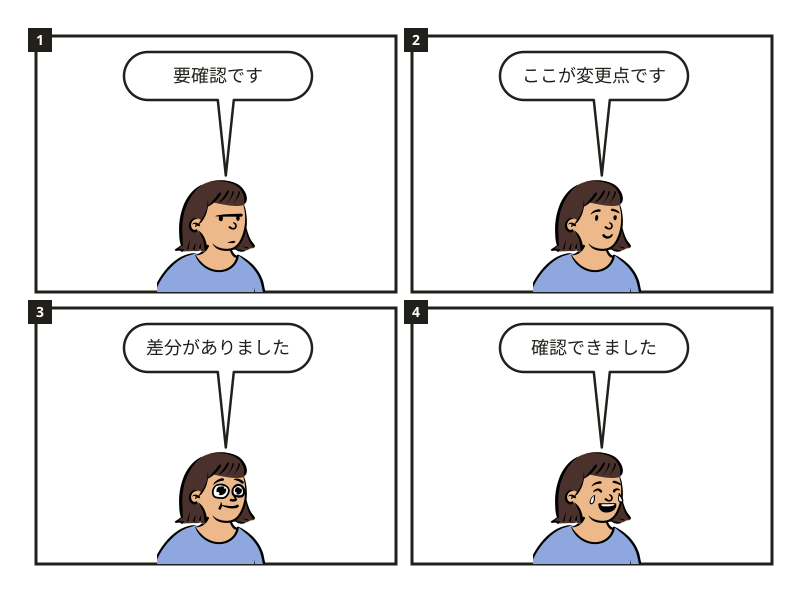

# 漫画に使える人物・漫符・小道具の素材

[Issue #443](https://github.com/cuzic/svg-diagram/issues/443) の調査と試作。人物の形式は [ADR 0074 D3・Q2](../../docs/adr/0074-comic-worksheet-parts.md#d3-キャラクターの素材) と [PR #442](https://github.com/cuzic/svg-diagram/pull/442)、漫符・小道具と色の変更は [ADR 0076 D1・Q11](../../docs/adr/0076-comic-extensions.md#d1-マンプ漫符と小道具) に基づく。

## 人物

2026-11-22 確認。「再配布」は npm パッケージやリポジトリに素材を入れて配ること。「判定」はこの調査での採用案。「参照のみ」は skill に出典を登録し、その素材を実際に使った成果物へ出典を自動で入れる運用を指す。「不可」は再配布の禁止、または自動で扱うための許諾が未確認のものを指す。

| 候補・ライセンス | 再配布 | 改変 | 商用 | 出典 | SA | 上限・禁止事項 | 画風・点数・形式・表情 | 判定と理由 |
| --- | --- | --- | --- | --- | --- | --- | --- | --- |
| Open Peeps · [CC0 1.0][cc0]、[公式][open-peeps] | 可 | 可 | 可 | 任意 | なし | CC0 に点数上限・用途制限なし | 手描き線画。立ち・座りのポーズと顔パーツ。作者配布は SVG/PNG。完成素材点数と原版の表情数は未確認。公式販売ページに 584,688 超の組み合わせの記載。DiceBear 版は頭 48・表情 30。 [作者の配布ページ][open-peeps-download] | **同梱可**。CC0 と部品の入手経路を確認済み。 |
| Humaaans · [CC0 1.0][cc0]、[公式][humaaans] | 可 | 可 | 可 | 任意 | なし | CC0 に点数上限・用途制限なし | 色面主体の全身。髪・衣服・立ち座りを組み替えられるベクター。デザインツール用の配布を確認。配布物中の個別 SVG、素材点数、表情数は未確認。 [作者の配布ページ][humaaans-download] | **同梱可**。CC0。ポーズの候補。表情の差し替えは要調査。 |
| Avataaars 原版 · [作者の個人・商用利用許諾][avataaars] | 未確認 | 公式に案内された組み替えと配色は可。部品の独立配布を伴う改変は未確認 | 可 | 未確認 | 未確認 | 点数上限・追加条件は未確認 | フラットなバストアップ。公式は Sketch ライブラリ。個別 SVG の配布、完成素材点数、原版の表情数は未確認。DiceBear 版は SVG 出力、口 12・目 12。 [作者の案内][avataaars] · [DiceBear の定義](DICEBEAR.md) | **不可**。素材ファイルとしての再配布許諾が未確認。 |
| DiceBear の 44 スタイル · [CC0 1.0][cc0]、[定義別の許諾][dicebear] | 可 | 可 | 可 | 任意 | なし | CC0 に点数上限・用途制限なし | Open Peeps、Notionists、Lorelei、Pixel Art など。固定の完成点数はなし。SVG に出力可。画風・部品点数と表情数は [スタイル別の表](DICEBEAR.md)。 | **同梱可**。人物系だけを選べる。 |
| DiceBear の 14 スタイル · [CC BY 4.0][cc-by]、[定義別の許諾][dicebear] | 条件付きで可 | 可 | 可 | 作者・出典・ライセンスと改変の表示が必要 | なし | 点数上限なし。許諾を妨げる追加制限は不可 | Adventurer、Big Ears、Croodles など。SVG に出力可。画風・部品点数と表情数は [スタイル別の表](DICEBEAR.md)。 | **参照のみ（出典を自動で入れる）**。法的には同梱も可能。配布する各図に出典を残せる運用から始める案。 |
| DiceBear Icons · [MIT][bootstrap-icons]、[定義別の許諾][dicebear] | 条件付きで可 | 可 | 可 | 著作権表示と許諾文の保持が必要 | なし | MIT に点数上限・用途制限なし | Bootstrap Icons の線画。記号 146 点の定義、SVG 出力、人物の表情なし。 [スタイル別の表](DICEBEAR.md) | **同梱可**。漫符・小道具の候補。著作権表示と許諾文を同梱。 |
| DiceBear Avataaars / Bottts（各簡略版を含む 4 スタイル）· [作者の個人・商用利用許諾を記載した定義別の許諾][dicebear] | 未確認 | 公式のオプションによる組み替えは可。部品の独立配布を伴う改変は未確認 | 可 | 未確認 | 未確認 | 素材の点数上限・追加条件は未確認 | フラットな人物 / ロボット。固定の完成点数はなし。SVG 出力。Avataaars は口 12・目 12、Bottts は口 9・目 14。 [スタイル別の表](DICEBEAR.md) | **不可**。素材ファイルの再配布許諾が未確認。 |
| Kenney Shape Characters 1.0 · [CC0 1.0][cc0]、[公式][kenney] | 可 | 可 | 可 | 任意 | なし | CC0 に点数上限・用途制限なし。公式ロゴは使用不可。 [公式 FAQ][kenney-faq] | 幾何図形のキャラクター。公式カタログに 100 点。作者の ZIP に PNG タイルと `Vector/overview.svg`、顔 5 点と口パーツ 4 種。 [Kenney の投稿と配布 ZIP][kenney-download] | **同梱可**。CC0。人物よりも幾何図形のキャラクター向き。 |

DiceBear の判定はアバターの素材ごとに行った。DiceBear の生成コードの MIT 許諾とは別に、各定義の `meta.license` に作者の許諾がある。 [DiceBear のライセンス一覧][dicebear]

## 表情・漫符・小道具

| 候補・ライセンス | 再配布 | 改変 | 商用 | 出典 | SA | 上限・禁止事項 | 画風・点数・形式・表情 | 判定と理由 |
| --- | --- | --- | --- | --- | --- | --- | --- | --- |
| Microsoft Fluent Emoji · [MIT][fluent-license] | 条件付きで可 | 可 | 可 | 著作権表示と許諾文の保持が必要 | なし | MIT に点数上限・用途制限なし | Flat はフラットな色面、Color は立体的な配色、High Contrast は高コントラスト。SVG 7,885 点（うち Flat 3,145 点）、表情は下記 8/8。 [公式素材ツリー][fluent-assets] | **同梱可**。同じスタイル内で部品を選び、許諾文を添付できる。 |
| Google Noto Emoji（`2D/svg`）· [Apache-2.0][noto-license] | 条件付きで可 | 可 | 可 | 許諾文・該当する表示を保持。改変ファイルに変更の表示、NOTICE がある場合は関連する記載を引き継ぐ。 [第 4 条][apache] | なし | 点数上限なし。商標の許諾は含まれない。フォントは OFL 1.1、地域旗は別条件なので集計対象外。 [公式 README][noto-licenses] | 陰影とグラデーションのある色面。2D SVG 3,750 点、表情は下記 8/8。 [公式素材ツリー][noto-assets] | **同梱可**。対象ディレクトリの許諾と改変の表示を保持。 |
| Twemoji（jdecked）· 画像は [CC BY 4.0][twemoji-license]、コードは MIT | 条件付きで可 | 可 | 可 | 作者・出典・ライセンスと改変の表示が必要。配布元は README やページのフッター等での表記を案内。 [公式の出典案内][twemoji-credit] | なし | 点数上限なし。許諾を妨げる追加制限は不可 | フラットな色面。SVG 4,009 点、表情は下記 8/8。 [公式素材ツリー][twemoji-assets] | **参照のみ（出典を自動で入れる）**。改変版の出典を図の配布先へ引き継ぐ運用から始める案。 |
| OpenMoji · 画像は [CC BY-SA 4.0][openmoji-license] | 条件付きで可 | 可 | 可 | 作者・出典・ライセンスと改変の表示が必要。 [公式の出典案内][openmoji-credit] | あり。公開する改変素材に同じライセンスまたは互換ライセンスが必要。 [Creative Commons][cc-by-sa] | 点数上限なし。許諾を妨げる追加制限は不可 | 輪郭が強い線画。カラー・黒線ともに SVG 4,567 点ずつ、表情は下記 8/8。 [公式素材ツリー][openmoji-assets] | **参照のみ（出典を自動で入れる）**。改変素材についての SA の運用を整えてから採用。出典表示だけでは SA を満たさない。 |
| いらすとや · [独自利用規定][irasutoya-terms]、[公式 FAQ][irasutoya-faq] | 素材としての再配布は加工後も不可 | 素材の印象を保つ加工は規約内で可 | デザインの一部として可。通常 1 制作物 20 点まで無料（重複は 1 点、Canva 内で完結する制作は別扱い） | 任意 | 規定なし。著作権は作者に帰属 | 素材を主体とする再配布・販売や画像編集アプリの素材収録は禁止。AI 学習の条件は未確認。 | 親しみやすいイラスト。人物・表情・小道具のカテゴリがある。透明 PNG で、ベクターの配布は未確認（FAQ ではベクターデータの販売なし）。総点数・同一人物の表情数は未確認。 [公式 FAQ][irasutoya-faq] | **不可**。改変の有無によらず素材パックとしての再配布を禁止。 |

絵文字 4 系列の 8/8 は、無表情 😐、笑み 🙂、大笑い 😂、驚き 😮、心配 😟、怒り 😠、考え中 🤔、悲しみ 😢 に対応する SVG を上記の公式素材ツリーで確認した結果。絵文字単体の数で、同じ人物の表情差分としては使えない。点数は対象ディレクトリの SVG ファイル数であり、肌色差分やシーケンスも含む。

ADR 0076 D1 の用途では、4 系列すべてで汗 💦、怒り 💢、きらめき ✨、疑問 ❓、感嘆 ❗、ハート ❤️、ひらめき 💡、睡眠 💤 と、小道具 6 種（💻 ☕ 📅 🕒 📄 📱）の SVG を確認した。ため息と落ち込みは頭に付く小さな記号として読みやすい絵の選定が残る。 [ADR 0076 D1](../../docs/adr/0076-comic-extensions.md#d1-マンプ漫符と小道具)

## Open Peeps の変換



[原本と取得記録](SOURCES.md) の DiceBear 版 Open Peeps から、胴体と頭の `bangs` を固定した人物を 1 人分作った。[変換スクリプト](convert.ts) が各顔部品に元の座標変換を適用し、[character.json](character.json) に SVG 断片とライセンスを出力する。

| ADR 0074 の表情 | 元の顔部品 | 採用した理由・限界 |
| --- | --- | --- |
| `neutral` | `serious` | 閉じた口と水平に近い眉。少し真顔寄り。 |
| `smile` | `smile` | 口角の上がった小さな笑み。 |
| `laugh` | `smileLOL` | 閉じた目と大きく開いた口。笑い涙つき。 |
| `surprise` | `awe` | 大きく見開いた目。口元に笑みが残る。 |
| `worry` | `concerned` | 眉の傾きと口の形で心配を表す。 |
| `angry` | `veryAngry` | 眉を寄せ、口角が下がる。 |
| `think` | **足りない** | `suspicious` は片眉が上がるが、疑いに見えるため採用しなかった。 |
| `sad` | `solemn` | 下がった眉と口角。 |

- **画風。** 元の胴、髪、輪郭を全表情で共通にしたため、顔を切り替えても同じ人物に見える。横向きの輪郭と手描きの線に対し、絵文字は正面の丸顔や異なる線幅が多い。漫符・小道具を採用するときは人物と並べ、線の太さと色数を確認する。
- **座標。** 元の 704 × 704 の座標系を引き継ぎ、胸元がコマ枠まで届くように `box` の高さを 860 まで広げた。頭は髪の上端とあごに合わせて中心 `(377, 347)`、半径 `230`。口は 7 表情の口元から共通の `(470, 485)` を選んだ。表情で口の中心は動くが、PR #442 の manifest に表情別アンカーはなく、ふきだしのしっぽは共通座標を向く。元の絵に手が描かれていないため、`hand` は省いた。
- **色。** `recolor` に肌、髪、服の 3 色だけを宣言した。黒の輪郭と顔の線は別色として保った。PR #442 は宣言を含む manifest を読み込めるが、色の置き換えは ADR 0076 U4 の範囲。この試作の SVG は元の配色で描画した。
- **大きさ。** 元定義は 192,322 B、7 表情の manifest は 40,519 B、4 コマ SVG は 27,442 B（UTF-8、圧縮前）。manifest は表情ごとに胴体と髪を持つため、人物や表情を追加する際は生成物と圧縮後のパッケージ容量を測る。

### 再現

PR #442 の検証時点のコミットを `git archive` でリポジトリ外に展開し、その `comic(sheet, {characters})` と `renderDiagram` を呼ぶ。型検査は、ルートの設定を継承するスパイク用の設定でも行う。描画スクリプトは XML・描画の検査と、4 コマ全部に対応する人物 SVG が出たことを確認する。

```sh
pnpm install --frozen-lockfile
pnpm typecheck
pnpm exec tsc -p spikes/comic-assets
node spikes/comic-assets/convert.ts
node --test spikes/comic-assets/convert.test.ts

git fetch origin feat/comic-u2
comic_u2_dir=$(mktemp -d)
git archive 3af0b91e8f7177a13a5b68652a285bf7fa21d48e lib package.json | tar -x -C "$comic_u2_dir"
ln -s "$PWD/node_modules" "$comic_u2_dir/node_modules"
node spikes/comic-assets/render.ts "$comic_u2_dir"
node spikes/comic-assets/render.ts "$comic_u2_dir" --check
```

`--check` は生成結果と保存済み SVG をバイト単位で比較する。文字幅計測に使われるフォントが異なる環境では、ふきだしの幅や文字位置も照合する。

## 次の ADR で決めること

| 項目 | 確認した事実 | 推奨 |
| --- | --- | --- |
| ライセンスの基準 | CC0 は出典の表示を必須とせず、MIT / Apache は配布物への通知の保持等、CC BY は出典と改変の表示、CC BY-SA は公開する改変素材の継承条件を伴う。 [CC0][cc0] · [MIT][fluent-license] · [Apache-2.0][apache] · [CC BY][cc-by] · [CC BY-SA][cc-by-sa] | 初回は CC0 の人物を同梱候補とする。MIT / Apache の漫符と小道具はファイルごとの来歴と通知を保持できるものから選ぶ。CC BY は参照で運用し、CC BY-SA は改変素材の配布条件を決めた段階で再検討する。 |
| パッケージの形 | 1 人の 7 表情で manifest が約 40 KB。ADR 0074 D3 は別パッケージと呼び出し側からの取得を想定する。 [ADR 0074 D3](../../docs/adr/0074-comic-worksheet-parts.md#d3-キャラクターの素材) | 人物ごとの manifest を選べる素材パッケージにする。skill は素材 id・収録表情・出典にリンクし、`think` 等の未収録表情があることも検索時に分かるようにする。 |
| 出典の表記 | PR #442 が要求する `license` は `spdx`・`author`・`url`。画像の出典を図に表示する仕組みや改変履歴はこのフィールドだけでは揃わない。 [PR #442](https://github.com/cuzic/svg-diagram/pull/442) | 出典 URL、許諾 URL、作者、改変の有無を素材台帳で管理する。CC BY 等を参照するときは、使用素材だけの出典を最終成果物に残す。SVG・HTML は図の近くか図中、PPTX は図とともに配布される位置を選ぶ。 |

[cc0]: https://creativecommons.org/publicdomain/zero/1.0/
[cc-by]: https://creativecommons.org/licenses/by/4.0/
[cc-by-sa]: https://creativecommons.org/licenses/by-sa/4.0/
[apache]: https://www.apache.org/licenses/LICENSE-2.0#redistribution
[open-peeps]: https://www.openpeeps.com/
[open-peeps-download]: https://pablostanley.gumroad.com/l/openpeeps
[humaaans]: https://www.humaaans.com/
[humaaans-download]: https://pablostanley.gumroad.com/l/humaaans
[avataaars]: https://www.avataaars.com/
[dicebear]: https://github.com/dicebear/styles/blob/09d9885d2313aec633a21dcf414857103053169f/LICENSE.md
[bootstrap-icons]: https://github.com/twbs/icons/blob/main/LICENSE
[kenney]: https://kenney.nl/assets/shape-characters
[kenney-faq]: https://kenney.nl/support
[kenney-download]: https://opengameart.org/content/shape-characters
[fluent-license]: https://github.com/microsoft/fluentui-emoji/blob/1ffb34c752ecf5d402f04cfb4b392c77f57c54bc/LICENSE
[fluent-assets]: https://github.com/microsoft/fluentui-emoji/tree/1ffb34c752ecf5d402f04cfb4b392c77f57c54bc/assets
[noto-license]: https://github.com/googlefonts/noto-emoji/blob/99701e07d3d1fe1bdbcdb14964547f0fd592966f/2D/svg/LICENSE
[noto-licenses]: https://github.com/googlefonts/noto-emoji/blob/99701e07d3d1fe1bdbcdb14964547f0fd592966f/README.md#license
[noto-assets]: https://github.com/googlefonts/noto-emoji/tree/99701e07d3d1fe1bdbcdb14964547f0fd592966f/2D/svg
[twemoji-license]: https://github.com/jdecked/twemoji/blob/b6b55fef1e8636b540a6d016a4729ca8cdf2e60b/LICENSE-GRAPHICS
[twemoji-credit]: https://github.com/jdecked/twemoji/blob/b6b55fef1e8636b540a6d016a4729ca8cdf2e60b/README.md#attribution-requirements
[twemoji-assets]: https://github.com/jdecked/twemoji/tree/b6b55fef1e8636b540a6d016a4729ca8cdf2e60b/assets/svg
[openmoji-license]: https://github.com/hfg-gmuend/openmoji/blob/3e01de523ddefe9c5e46a7765b15efef04bf9002/LICENSE.txt
[openmoji-credit]: https://github.com/hfg-gmuend/openmoji/blob/3e01de523ddefe9c5e46a7765b15efef04bf9002/README.md#attribution-requirements
[openmoji-assets]: https://github.com/hfg-gmuend/openmoji/tree/3e01de523ddefe9c5e46a7765b15efef04bf9002/black/svg
[irasutoya-terms]: https://www.irasutoya.com/p/terms.html?m=1
[irasutoya-faq]: https://www.irasutoya.com/p/faq.html?m=1
